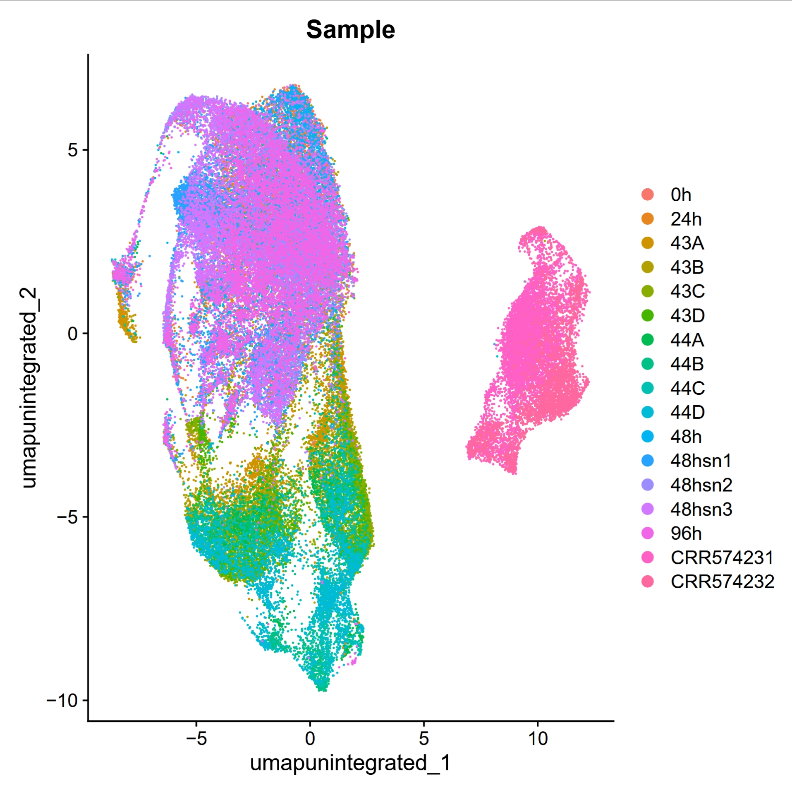
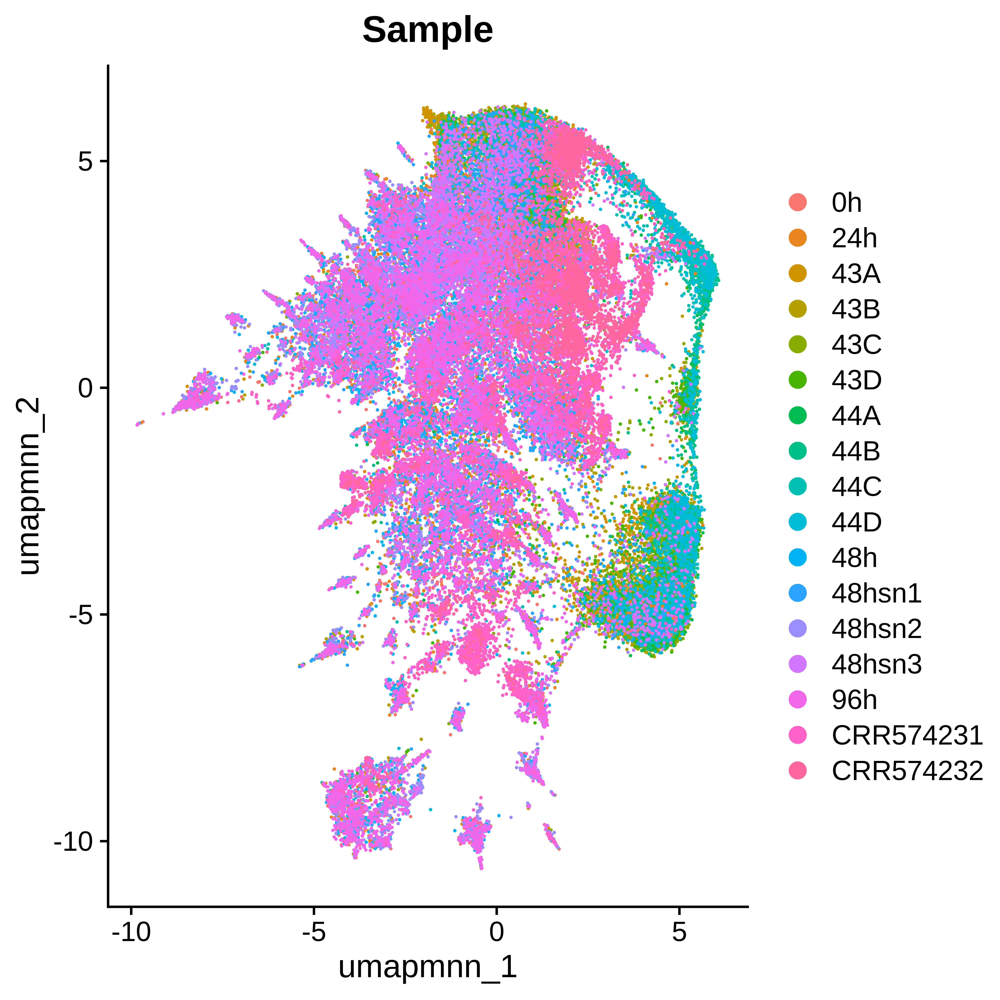
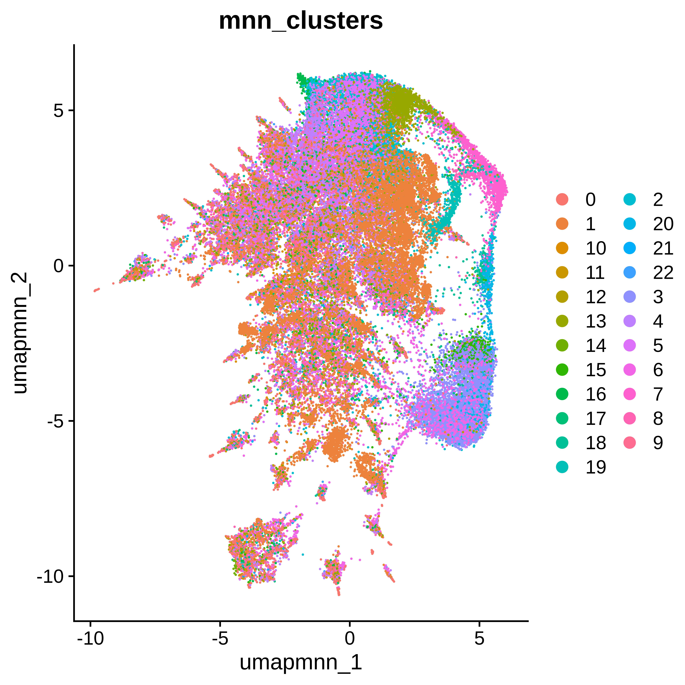
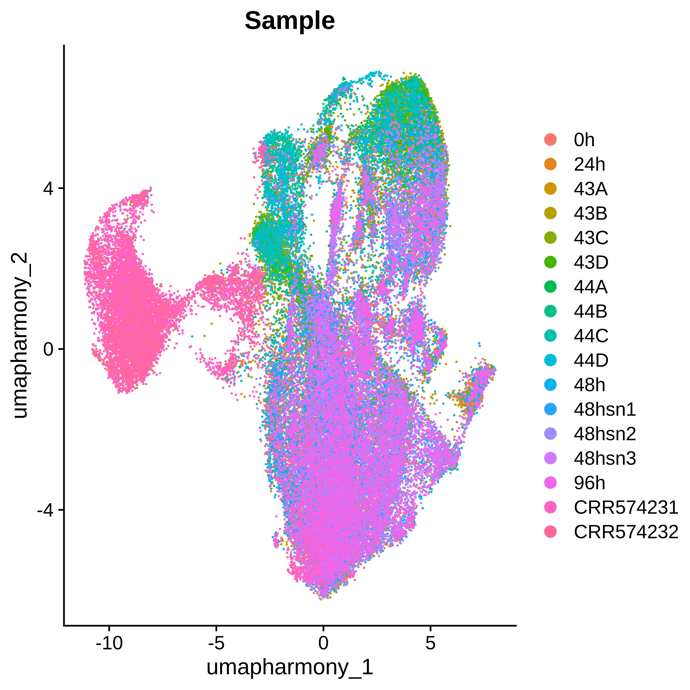
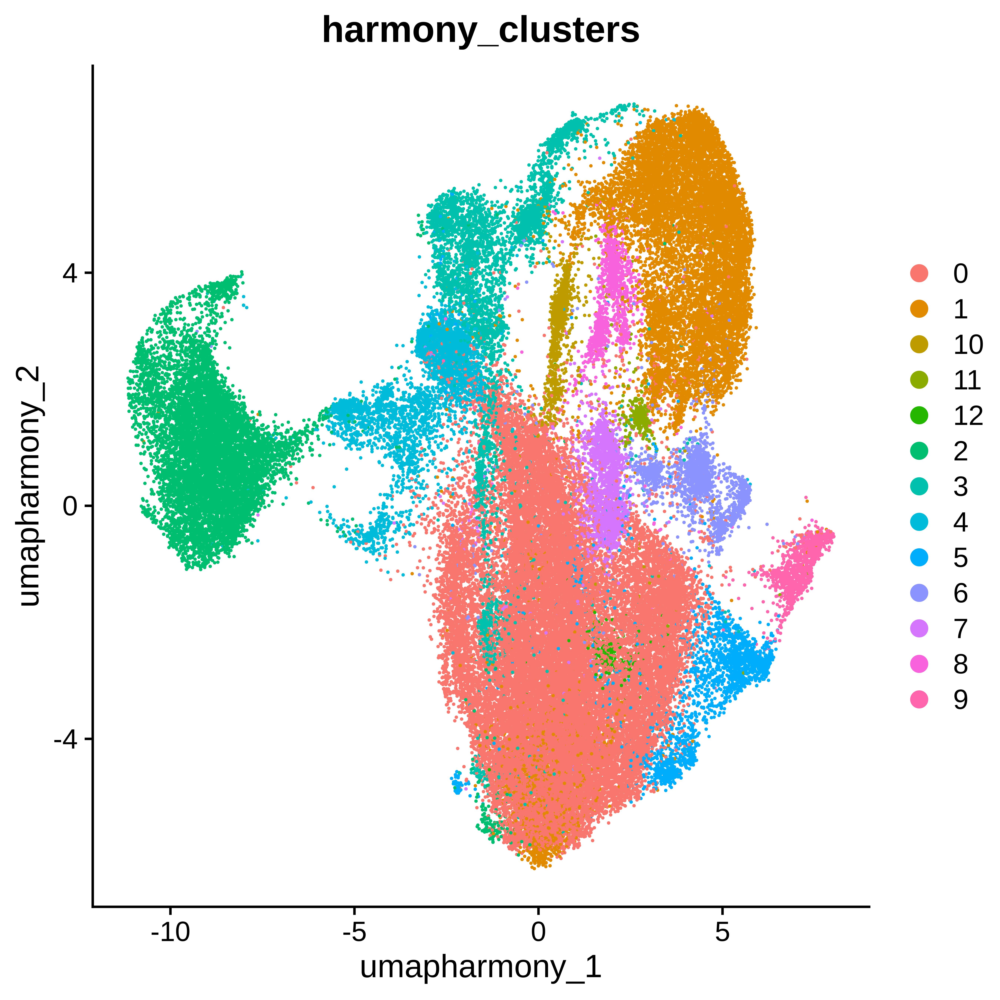
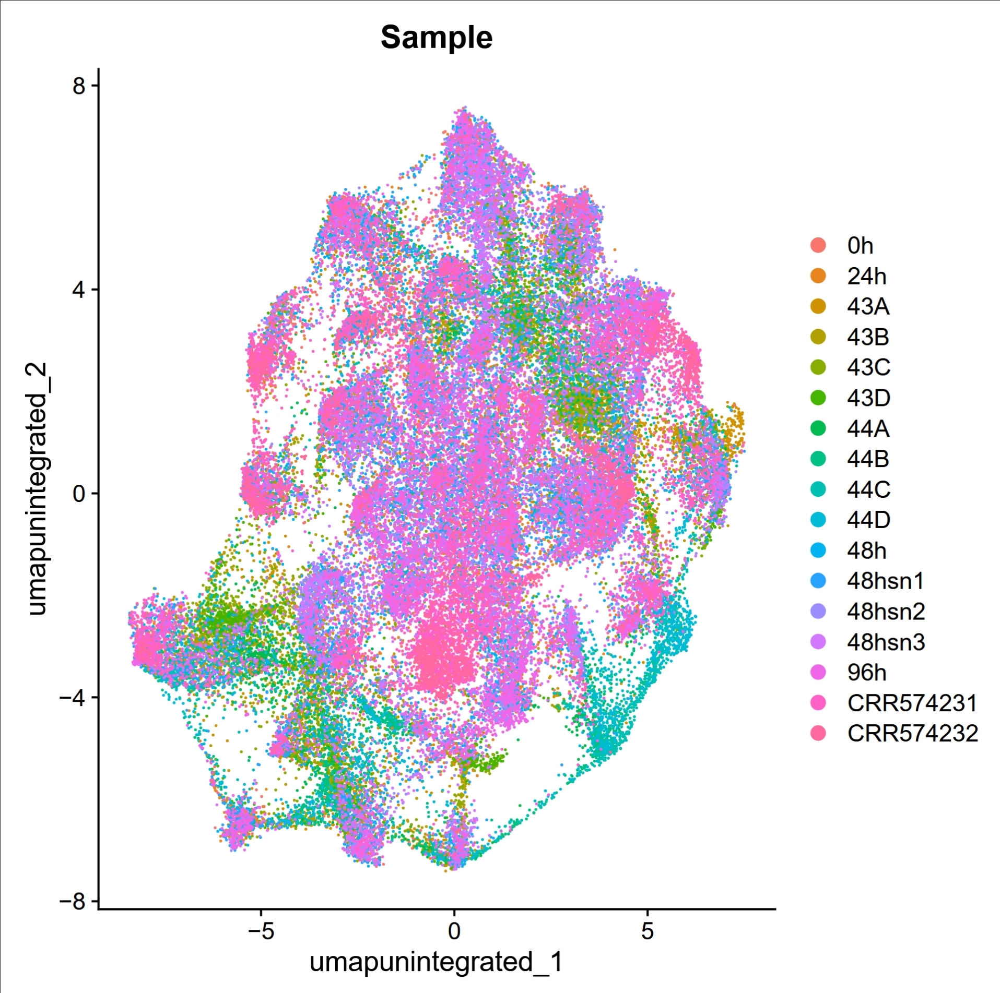
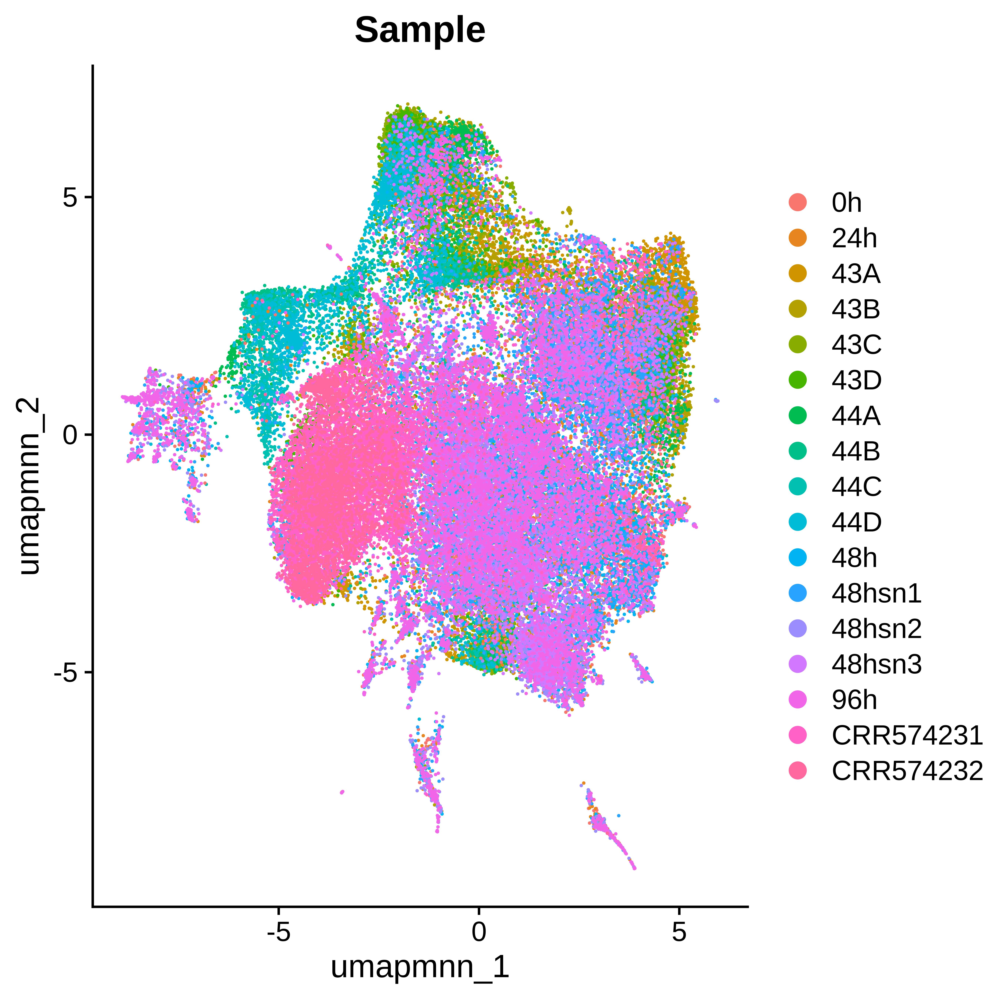
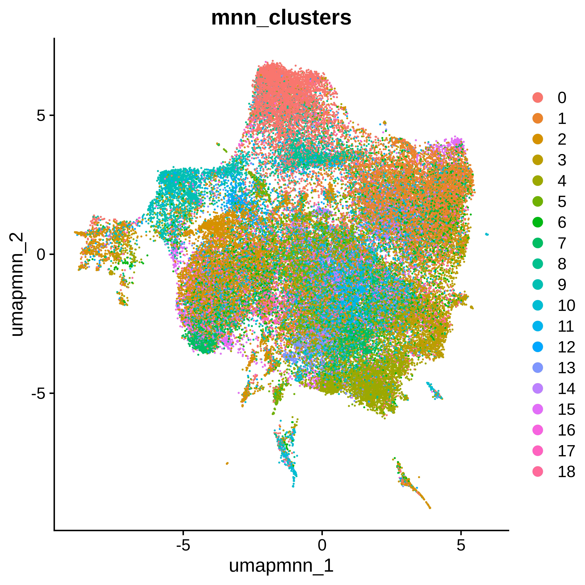
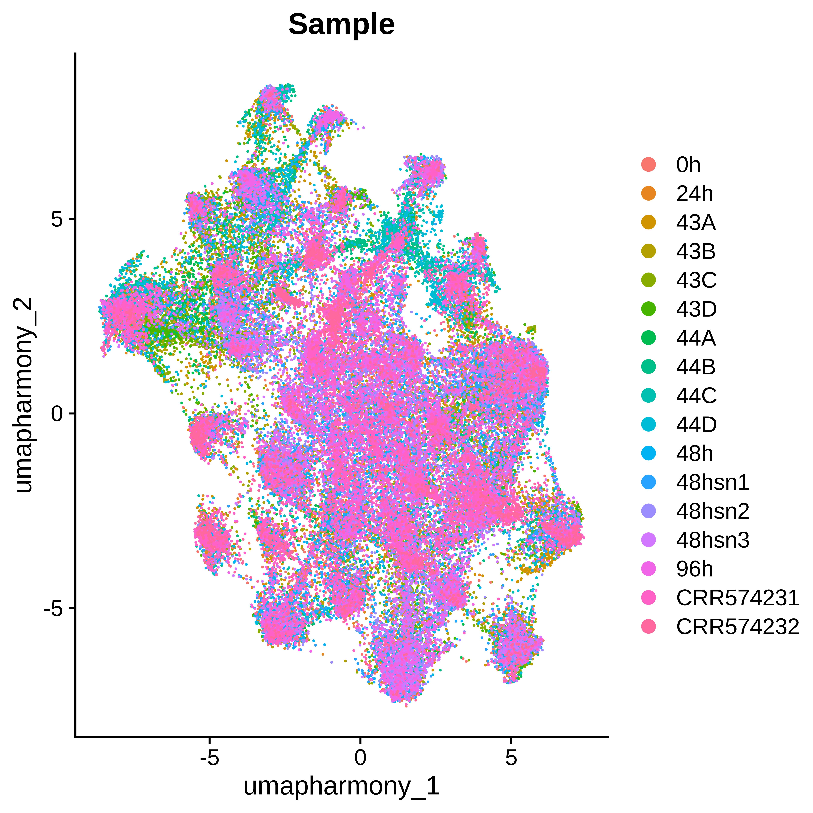
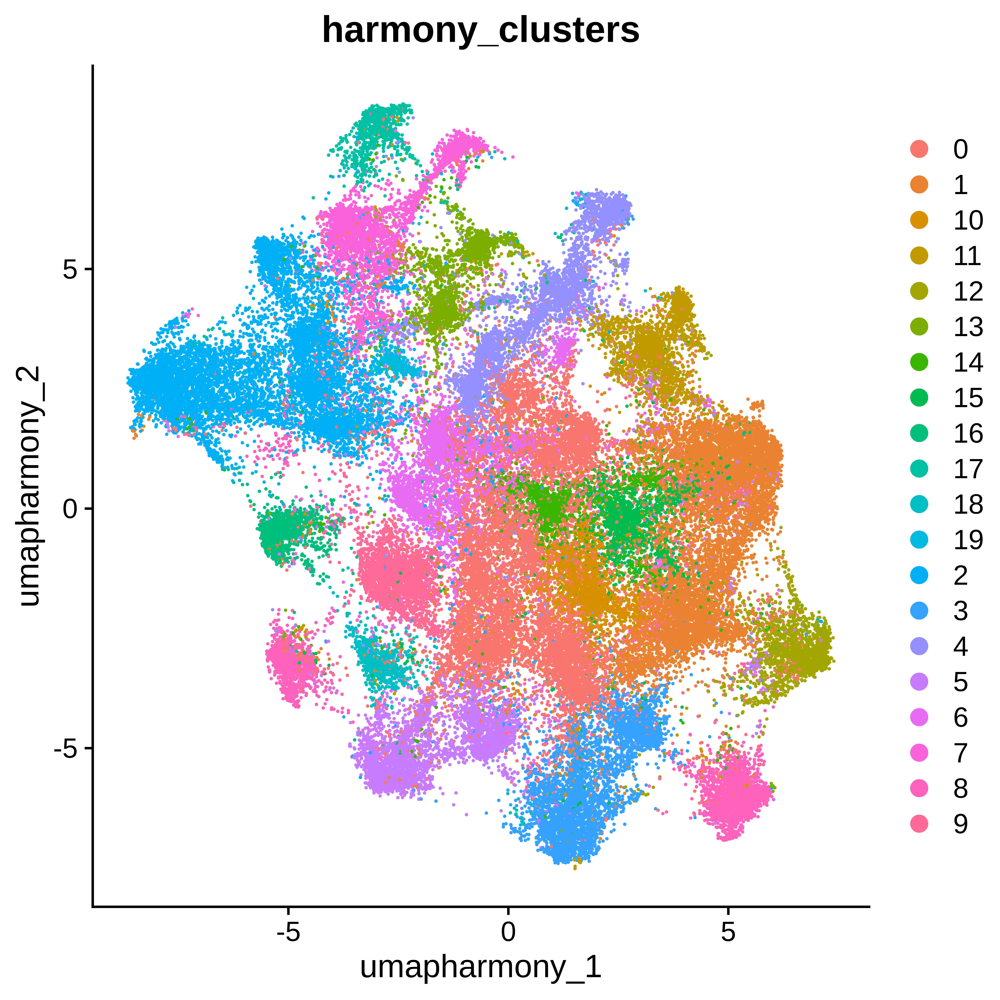

# Integration of Single-Nucleus RNA-Seq and Spatial Transcriptomics Data

This pipeline is part of a single-cell analysis project.
This pipeline integrates 17 datasets, including 9 single-nucleus RNA-seq (snRNA-seq) datasets and 8 spatial transcriptomics datasets (each has 480 probes), to create a combined Seurat object for downstream analysis. The integration is performed using two different methods: FastMNN and Harmony; and two normalization methods: 'general' normalization and 'SCTransform'. (adapted from https://satijalab.org/seurat/articles/seurat5_integration)

## Pipeline Overview

The analysis can be broken down into the following steps:

1.  **Data Loading**: The pipeline begins by loading 9 snRNA-seq datasets from 10X HDF5 files and 8 spatial transcriptomics datasets from RDS files.

2.  **Gene Intersection**: To ensure compatibility between the datasets, the pipeline identifies the intersection of genes present across all 17 datasets. This results in a common set of 480 genes that are used for the integration.

3.  **Data Merging**: The individual datasets are merged into a single Seurat object. During this step, sample names are added to the metadata to distinguish between the different datasets.

4.  **Standard Analysis (No Integration)**: Before integration, a standard Seurat analysis is performed on the combined dataset. This includes:
    *   Normalization (`NormalizeData`)
    *   Scaling (`ScaleData`)
    *   Principal Component Analysis (`RunPCA`)
    *   UMAP visualization (`RunUMAP`)

5.  **Integration**: The pipeline then uses two different methods to integrate the datasets and correct for batch effects:
    *   **FastMNN**: The `IntegrateLayers` function with `method = FastMNNIntegration` is used to perform the integration. The results are visualized in a UMAP plot.
    *   **Harmony**: The `IntegrateLayers` function with `method = HarmonyIntegration` is used for an alternative integration. The results are also visualized in a UMAP plot.


Working environment:
```bash
cd /data/pathology/cxia/projects/Giles/Min-Yao/004.Integration_6snRNAseq_8spatialTranscriptome-480genes
mamba activate R4.2.3
/data/pathology/program/Miniforge3/envs/R4.2.3/bin/R
```

```R
library(Seurat)
library(harmony)
library(SeuratWrappers)
library(sceasy)
library(batchelor)
```
## Datasets merge
The core of this pipeline is the careful merging of 17 individual datasets into a single, cohesive Seurat object ready for integration. The strategy ensures that all datasets are comparable and structured correctly for layer-based batch correction methods like `FastMNN` and `Harmony`.
```R
## Step0.1 create Seurat Object from raw counts for single-cell RNAseq data
# All 17 Seurat objects (9 snRNA-seq and 8 spatial) are first loaded and then collected into a single list named `datasets`.
A17_0h <- Read10X_h5("/data/pathology/cxia/projects/Giles/Min-Yao/02.scRNAseq.QC/A17_0h/filtered_feature_bc_matrix.h5", use.names=T)
A17_0h.obj <- CreateSeuratObject(counts = A17_0h, project="A17_0h")
A17_0h.obj <- RenameAssays(object = A17_0h.obj, assay.name = "RNA", new.assay.name = "Xenium") #use same assay name for subset

A17_24h <- Read10X_h5("/data/pathology/cxia/projects/Giles/Min-Yao/02.scRNAseq.QC/A17_24h/filtered_feature_bc_matrix.h5")
A17_24h.obj <- CreateSeuratObject(counts = A17_24h, project="A17_24h")
A17_24h.obj <- RenameAssays(object = A17_24h.obj, assay.name = "RNA", new.assay.name = "Xenium")

A17_48h <- Read10X_h5("/data/pathology/cxia/projects/Giles/Min-Yao/02.scRNAseq.QC/A17_48h/filtered_feature_bc_matrix.h5")
A17_48h.obj <- CreateSeuratObject(counts = A17_48h, project="A17_48h")
A17_48h.obj <- RenameAssays(object = A17_48h.obj, assay.name = "RNA", new.assay.name = "Xenium")

A17_48hsn1 <- Read10X_h5("/data/pathology/cxia/projects/Giles/Min-Yao/02.scRNAseq.QC/A17_48h-sn1/filtered_feature_bc_matrix.h5")
A17_48hsn1.obj <- CreateSeuratObject(counts = A17_48hsn1, project="A17_48hsn1")
A17_48hsn1.obj <- RenameAssays(object = A17_48hsn1.obj, assay.name = "RNA", new.assay.name = "Xenium")

A17_48hsn2 <- Read10X_h5("/data/pathology/cxia/projects/Giles/Min-Yao/02.scRNAseq.QC/A17_48h-sn2/filtered_feature_bc_matrix.h5")
A17_48hsn2.obj <- CreateSeuratObject(counts = A17_48hsn2, project="A17_48hsn2")
A17_48hsn2.obj <- RenameAssays(object = A17_48hsn2.obj, assay.name = "RNA", new.assay.name = "Xenium")

A17_48hsn3 <- Read10X_h5("/data/pathology/cxia/projects/Giles/Min-Yao/02.scRNAseq.QC/A17_48h-sn3/filtered_feature_bc_matrix.h5")
A17_48hsn3.obj <- CreateSeuratObject(counts = A17_48hsn3, project="A17_48hsn3")
A17_48hsn3.obj <- RenameAssays(object = A17_48hsn3.obj, assay.name = "RNA", new.assay.name = "Xenium")

A17_96h <- Read10X_h5("/data/pathology/cxia/projects/Giles/Min-Yao/02.scRNAseq.QC/A17_96h/filtered_feature_bc_matrix.h5")
A17_96h.obj <- CreateSeuratObject(counts = A17_96h, project="A17_96h")
A17_96h.obj <- RenameAssays(object = A17_96h.obj, assay.name = "RNA", new.assay.name = "Xenium")

A17_CRR574231 <- Read10X_h5("/data/pathology/cxia/projects/Giles/Min-Yao/02.scRNAseq.QC/CRR574231/filtered_feature_bc_matrix.h5")
A17_CRR574231.obj <- CreateSeuratObject(counts = A17_CRR574231, project="A17_CRR574231")
A17_CRR574231.obj <- RenameAssays(object = A17_CRR574231.obj, assay.name = "RNA", new.assay.name = "Xenium")

A17_CRR574232 <- Read10X_h5("/data/pathology/cxia/projects/Giles/Min-Yao/02.scRNAseq.QC/CRR574232/filtered_feature_bc_matrix.h5")
A17_CRR574232.obj <- CreateSeuratObject(counts = A17_CRR574232, project="A17_CRR574232")
A17_CRR574232.obj <- RenameAssays(object = A17_CRR574232.obj, assay.name = "RNA", new.assay.name = "Xenium")


datasets <- list()
datasets[[1]] <- readRDS("../002.integration_spatial_14datasets/xenium_obj_43A.rds")
datasets[[2]] <- readRDS("../002.integration_spatial_14datasets/xenium_obj_43B.rds")
datasets[[3]] <- readRDS("../002.integration_spatial_14datasets/xenium_obj_43C.rds")
datasets[[4]] <- readRDS("../002.integration_spatial_14datasets/xenium_obj_43D.rds")
datasets[[5]] <- readRDS("../002.integration_spatial_14datasets/xenium_obj_44A.rds")
datasets[[6]] <- readRDS("../002.integration_spatial_14datasets/xenium_obj_44B.rds")
datasets[[7]] <- readRDS("../002.integration_spatial_14datasets/xenium_obj_44C.rds")
datasets[[8]] <- readRDS("../002.integration_spatial_14datasets/xenium_obj_44D.rds")

DefaultAssay(datasets[[1]]) <- "Xenium"
DefaultAssay(datasets[[2]]) <- "Xenium"
DefaultAssay(datasets[[3]]) <- "Xenium"
DefaultAssay(datasets[[4]]) <- "Xenium"
DefaultAssay(datasets[[5]]) <- "Xenium"
DefaultAssay(datasets[[6]]) <- "Xenium"
DefaultAssay(datasets[[7]]) <- "Xenium"
DefaultAssay(datasets[[8]]) <- "Xenium"
```
To combine the datasets, they must share the same set of features (genes). The pipeline identifies the intersection of genes present across all 17 datasets, resulting in a shared panel of 480 genes.
```R
# Step1: intersection of gene names across your datasets
common_genes <- Reduce(intersect, lapply(datasets, function(x) {
  rownames(LayerData(x, assay = "Xenium", layer = "counts"))
}))
common_genes
#  [1] "MtrunA17Chr1g0146201" "MtrunA17Chr1g0147491" "MtrunA17Chr1g0147631"
#  [4] "MtrunA17Chr1g0148771" "MtrunA17Chr1g0149651" "MtrunA17Chr1g0150511"
#  ...
#  [475] "MtrunA17Chr8g0390311" "MtrunA17Chr8g0390531" "MtrunA17Chr8g0390971"
#  [478] "MtrunA17Chr8g0392301" "MtrunA17Chr8g0392991" "MtrunA17Chr8g0393021"

datasets[[9]] <- A17_0h.obj
datasets[[10]] <- A17_24h.obj
datasets[[11]] <- A17_48h.obj
datasets[[12]] <- A17_48hsn1.obj
datasets[[13]] <- A17_48hsn2.obj
datasets[[14]] <- A17_48hsn3.obj
datasets[[15]] <- A17_96h.obj
datasets[[16]] <- A17_CRR574231.obj
datasets[[17]] <- A17_CRR574232.obj
```
Each Seurat object in the `datasets` list is then processed. Its `Xenium` assay is replaced with a new, smaller version containing only the counts for the 480 common genes. This creates a new list of subsetted datasets.
```R
# Step2: Subset each dataset, for Xenium assay
datasets_subset <- lapply(datasets, function(x) {
  # Extract the counts layer from the Xenium assay
  counts_layer <- x[["Xenium"]]$counts

  # Ensure common_genes are present in counts_layer
  common_genes <- intersect(common_genes, rownames(counts_layer))

  # Subset the counts layer to include only common_genes
  subset_counts <- counts_layer[common_genes, ]

  # Create a new Assay5 object with the subsetted counts
  new_assay <- CreateAssay5Object(counts = subset_counts)

  # Replace the Xenium assay in the Seurat object
  x[["Xenium"]] <- new_assay

  return(x)
})
```
The `merge()` function is used to combine the 17 subsetted objects into a single large Seurat object named `seurat_combined`. The `add.cell.ids` argument is used to prefix each cell's barcode with its sample of origin, ensuring traceability.
After merging, custom metadata for `Sample` and `batch_id` is added to the object. Critically, for the integration to work, the merged `Xenium` assay is split into multiple layers using the `split()` function. Each layer corresponds to one of the original datasets, fulfilling the requirement for the `IntegrateLayers` function.
```R
# Step3: merge all 17 subsetted datasets
options(future.globals.maxSize = 2000 * 1024^2)  # Increase the global variable size limit
seurat_combined <- merge(
  x = datasets_subset[[1]],
  y = datasets_subset[-1],
  add.cell.ids = c("43A", "43B", "43C", "43D", "44A", "44B", "44C", "44D","0h", "24h", "48h", "48hsn1", "48hsn2", "48hsn3", "96h", "CRR574231", "CRR574232")
)

# add Sample names to meta.data, these numbers are number of cells in each sample
sample_names <- c(
  rep("43A", 2903),
  rep("43B", 3489),
  rep("43C", 3894),
  rep("43D", 1640),
  rep("44A", 1310),
  rep("44B", 2266),
  rep("44C", 1607),
  rep("44D", 2261),
  rep("0h", 4377),
  rep("24h", 3578),
  rep("48h", 5066),
  rep("48hsn1", 5833),
  rep("48hsn2", 7231),
  rep("48hsn3", 4725),
  rep("96h", 7783),
  rep("CRR574231", 7729),
  rep("CRR574232", 2724)
)
seurat_combined@meta.data$Sample <- sample_names
seurat_combined$batch_id <- sample_names

saveRDS(seurat_combined,"01.all17Obj_480genes.raw.rds")
```
## Seurat Normalization
Now we will test the two normalization methods, first one is the 'general' normaliztion in Seurat5.
```R
# Step4: normalization and dimension reduction
# must have follow subset step, otherwise error:
#Error in make_cell_attr(umi, cell_attr, latent_var, batch_var, latent_var_nonreg,  :
#  cell attribute "log_umi" contains NA, NaN, or infinite value
seurat_combined <- subset(seurat_combined, subset = nCount_Xenium > 0)
seurat_combined <- NormalizeData(seurat_combined)
# seurat_combined <- FindVariableFeatures(seurat_combined) # we set all 480 genes as variable features, so do not find variable features
VariableFeatures(seurat_combined[["Xenium"]]) <- rownames(seurat_combined[["Xenium"]])
seurat_combined <- ScaleData(seurat_combined)
seurat_combined <- RunPCA(seurat_combined)
# visualize the results of a standard analysis without integration.
seurat_combined <- FindNeighbors(seurat_combined, dims = 1:30, reduction = "pca")
seurat_combined <- FindClusters(seurat_combined, resolution = 2, cluster.name = "unintegrated_clusters")
seurat_combined <- RunUMAP(seurat_combined, dims = 1:30, reduction = "pca", reduction.name = "umap.unintegrated")
# visualize by batch (sample)
pdf("01.sample.effect.UMAP.pdf")
DimPlot(seurat_combined, reduction = "umap.unintegrated", group.by = "Sample")
dev.off()
jpeg("01.sample.effect.UMAP.jpeg", width = 6, height = 6, units = "in", res = 900)
DimPlot(seurat_combined, reduction = "umap.unintegrated", group.by = "Sample")
dev.off()

saveRDS(seurat_combined, file="02.all17Obj_480genes.defaultNormalize.UMAP.SeuratObj.rds")
```
Here is UMAP plot of sample effect.

```R
#Step5: integration using FastMNN
# Layers must represent batches (e.g., samples) in the assay being used for integration.
# otherwise, get error when IntegrateLayers: Error in .check_valid_batch(batches[[1]], batch = batch) 
seurat_combined[["Xenium"]] <- split(seurat_combined[["Xenium"]], f = seurat_combined$orig.ident)

obj_mnn <- IntegrateLayers(
 object = seurat_combined,
 method = FastMNNIntegration,
 assay = "Xenium",                # Explicitly use Xenium assay
 features = VariableFeatures(seurat_combined),  # Force use of 50 features
 layer = "data",               # Use normalized data (not counts/scale.data)
 new.reduction = "integrated.mnn",
 verbose = FALSE
)

obj_mnn <- FindNeighbors(obj_mnn, reduction = "integrated.mnn", dims = 1:30)
obj_mnn <- FindClusters(obj_mnn, resolution = 0.5, cluster.name = "mnn_clusters")
obj_mnn <- RunUMAP(obj_mnn, reduction = "integrated.mnn", dims = 1:30, reduction.name = "umap.mnn")

pdf("02.sample_effect_UMAP_integrated.mnn.pdf")
DimPlot(
  obj_mnn,
  reduction = "umap.mnn",
  group.by = c("Sample", "mnn_clusters"),
  combine = FALSE, label.size = 2
)
dev.off()
jpeg("02.sample_effect_UMAP_integrated-Sample.mnn.jpeg", width = 6, height = 6, units = "in", res = 900)
DimPlot(
  obj_mnn,
  reduction = "umap.mnn",
  group.by = "Sample",
  combine = FALSE, label.size = 2
)
dev.off()
jpeg("02.sample_effect_UMAP_integrated-Cluster.mnn.jpeg", width = 6, height = 6, units = "in", res = 900)
DimPlot(
  obj_mnn,
  reduction = "umap.mnn",
  group.by = "mnn_clusters",
  combine = FALSE, label.size = 2
)
dev.off()

obj_mnn_joint <- JoinLayers(obj_mnn)
saveRDS(obj_mnn_joint, file="04.all_sample_joint.MNN.SeuratObj.rds")
```
Here are UMAP clusters of MNN-integrated samples.
<table>
  <tr>
    <td></td>
    <td></td>
  </tr>
</table>

```R
#################### following Harmony integration, it looks BETTER !!!!!!
#Step6: integration using Harmony
obj_harmony <- IntegrateLayers(
  object = seurat_combined, method = HarmonyIntegration,
  assay = "Xenium", features = VariableFeatures(seurat_combined), layer = "data",
  orig.reduction="pca", new.reduction = "harmony", verbose = FALSE
)

obj_harmony <- FindNeighbors(obj_harmony, reduction = "harmony", dims = 1:30)
obj_harmony <- FindClusters(obj_harmony, resolution = 0.2, cluster.name = "harmony_clusters")
obj_harmony <- RunUMAP(obj_harmony, reduction = "harmony", dims = 1:30, reduction.name = "umap.harmony")

pdf("05.sample_effect_UMAP_integrated.harmony.pdf")
DimPlot(
  obj_harmony,
  reduction = "umap.harmony",
  group.by = c("Sample", "harmony_clusters"),
  combine = FALSE, label.size = 2
)
dev.off()
jpeg("05.sample_effect_UMAP_integrated-Sample.harmony.jpeg", width = 6, height = 6, units = "in", res = 900)
DimPlot(
  obj_harmony,
  reduction = "umap.harmony",
  group.by = "Sample",
  combine = FALSE, label.size = 2
)
dev.off()
jpeg("05.sample_effect_UMAP_integrated-Cluster.harmony.jpeg", width = 6, height = 6, units = "in", res = 900)
DimPlot(
  obj_harmony,
  reduction = "umap.harmony",
  group.by = "harmony_clusters",
  combine = FALSE, label.size = 2
)
dev.off()

obj_harmony_joint <- JoinLayers(obj_harmony)
saveRDS(obj_harmony_joint, file="05.all_sample_joint.harmony.SeuratObj.rds")
```
Here are UMAP clusters of Harmony-integrated samples.
<table>
  <tr>
    <td></td>
    <td></td>
  </tr>
</table>

Now we will test `SCTransform` normalization, still with `FastMNN` and `Harmony` integration methods.

## ScTransform
```R
##############################################################################
## Following is to try SCTranform
##############################################################################
# Step4: normalization and dimension reduction
# must have follow subset step, otherwise error:
#Error in make_cell_attr(umi, cell_attr, latent_var, batch_var, latent_var_nonreg,  :
#  cell attribute "log_umi" contains NA, NaN, or infinite value
seurat_SCT <- readRDS("01.all17Obj_480genes.raw.rds")
seurat_SCT <- subset(seurat_SCT, subset = nCount_Xenium > 0)
seurat_SCT <- SCTransform(seurat_SCT, assay="Xenium") ##Only use SCTransform
# seurat_combined <- FindVariableFeatures(seurat_combined) # we set all 480 genes as variable features, so do not find variable features
VariableFeatures(seurat_SCT[["Xenium"]]) <- rownames(seurat_SCT[["Xenium"]])
seurat_SCT <- RunPCA(seurat_SCT)
# visualize the results of a standard analysis without integration.
seurat_SCT <- FindNeighbors(seurat_SCT, dims = 1:30, reduction = "pca")
seurat_SCT <- FindClusters(seurat_SCT, resolution = 2, cluster.name = "unintegrated_clusters")
seurat_SCT <- RunUMAP(seurat_SCT, dims = 1:30, reduction = "pca", reduction.name = "umap.unintegrated")
# visualize by batch (sample)
pdf("11.sample.effect.UMAP.pdf")
DimPlot(seurat_SCT, reduction = "umap.unintegrated", group.by = "Sample")
dev.off()

saveRDS(seurat_SCT, file="12.all17Obj_480genes.SCT.UMAP.SeuratObj.rds")
```
Again let's check sample effect by UMAP plot.


```R
#Step5: integration using FastMNN
# Layers must represent batches (e.g., samples) in the assay being used for integration.
# otherwise, get error when IntegrateLayers: Error in .check_valid_batch(batches[[1]], batch = batch) 
seurat_SCT[["SCT"]] <- split(seurat_SCT[["SCT"]], f = seurat_combined$orig.ident)

objSCT_mnn <- IntegrateLayers(
 object = seurat_SCT,
 method = FastMNNIntegration,
 assay = "SCT",                # Explicitly use Xenium assay
 features = VariableFeatures(seurat_SCT),  # Force use of 50 features
 layer = "data",               # Use normalized data (not counts/scale.data)
 new.reduction = "integrated.mnn",
 verbose = FALSE
)


objSCT_mnn <- FindNeighbors(objSCT_mnn, reduction = "integrated.mnn", dims = 1:30)
objSCT_mnn <- FindClusters(objSCT_mnn, resolution = 0.2, cluster.name = "mnn_clusters")
objSCT_mnn <- RunUMAP(objSCT_mnn, reduction = "integrated.mnn", dims = 1:30, reduction.name = "umap.mnn")

pdf("12.sampleSCT_effect_UMAP_integrated.mnn.pdf")
DimPlot(
  objSCT_mnn,
  reduction = "umap.mnn",
  group.by = c("Sample", "mnn_clusters"),
  combine = FALSE, label.size = 2
)
dev.off()
jpeg("12.sampleSCT_effect_UMAP_integrated.mnn-Sample.jpeg", width = 6, height = 6, units = "in", res = 900)
DimPlot(
  objSCT_mnn,
  reduction = "umap.mnn",
  group.by = "Sample",
  combine = FALSE, label.size = 2
)
dev.off()
jpeg("12.sampleSCT_effect_UMAP_integrated.mnn-Cluster.jpeg", width = 6, height = 6, units = "in", res = 900)
DimPlot(
  objSCT_mnn,
  reduction = "umap.mnn",
  group.by = "mnn_clusters",
  combine = FALSE, label.size = 2
)
dev.off()


objSCT_mnn_joint <- JoinLayers(objSCT_mnn)
saveRDS(objSCT_mnn_joint, file="14.all_sampleSCT_joint.MNN.SeuratObj.rds")
```
Here are UMAP clusters of Harmony-integrated samples.
<table>
  <tr>
    <td></td>
    <td></td>
  </tr>
</table>

```R
#################### following Harmony integration
#Step6: integration using Harmony
objSCT_harmony <- IntegrateLayers(
  object = seurat_SCT, method = HarmonyIntegration,
  assay = "SCT", features = VariableFeatures(seurat_combined), layer = "data",
  orig.reduction="pca", new.reduction = "harmony", verbose = FALSE
)

objSCT_harmony <- FindNeighbors(objSCT_harmony, reduction = "harmony", dims = 1:30)
objSCT_harmony <- FindClusters(objSCT_harmony, resolution = 0.2, cluster.name = "harmony_clusters")
objSCT_harmony <- RunUMAP(objSCT_harmony, reduction = "harmony", dims = 1:30, reduction.name = "umap.harmony")

pdf("15.sampleSCT_effect_UMAP_integrated.harmony.pdf")
DimPlot(
  objSCT_harmony,
  reduction = "umap.harmony",
  group.by = c("Sample", "harmony_clusters"),
  combine = FALSE, label.size = 2
)
dev.off()
jpeg("15.sampleSCT_effect_UMAP_integrated.harmony-Sample.jpeg", width = 6, height = 6, units = "in", res = 900)
DimPlot(
  objSCT_harmony,
  reduction = "umap.harmony",
  group.by = "Sample",
  combine = FALSE, label.size = 2
)
dev.off()
jpeg("15.sampleSCT_effect_UMAP_integrated.harmony-Cluster.jpeg", width = 6, height = 6, units = "in", res = 900)
DimPlot(
  objSCT_harmony,
  reduction = "umap.harmony",
  group.by = "harmony_clusters",
  combine = FALSE, label.size = 2
)
dev.off()

objSCT_harmony_joint <- JoinLayers(objSCT_harmony)
saveRDS(objSCT_harmony_joint, file="15.all_sample_joint.harmony.SeuratObj.rds")
```
Here are UMAP clusters of Harmony-integrated samples.
<table>
  <tr>
    <td></td>
    <td></td>
  </tr>
</table>


#################################################
## END, Chongjing Xia, xiachongjing@gmail.com  ##
#################################################

## Env info
```R
#### Environment Information
sessionInfo()
R version 4.4.1 (2024-06-14)
Platform: x86_64-conda-linux-gnu
Running under: Debian GNU/Linux 11 (bullseye)

Matrix products: default
BLAS/LAPACK: /data/pathology/program/Miniforge3/envs/R4.2.3/lib/libopenblasp-r0.3.27.so;  LAPACK version 3.12.0

locale:
 [1] LC_CTYPE=en_GB.UTF-8       LC_NUMERIC=C
 [3] LC_TIME=en_GB.UTF-8        LC_COLLATE=en_GB.UTF-8
 [5] LC_MONETARY=en_GB.UTF-8    LC_MESSAGES=en_GB.UTF-8
 [7] LC_PAPER=en_GB.UTF-8       LC_NAME=C
 [9] LC_ADDRESS=C               LC_TELEPHONE=C
[11] LC_MEASUREMENT=en_GB.UTF-8 LC_IDENTIFICATION=C

time zone: Europe/London
tzcode source: system (glibc)

attached base packages:
[1] stats4    stats     graphics  grDevices utils     datasets  methods
[8] base

other attached packages:
 [1] batchelor_1.20.0            SingleCellExperiment_1.26.0
 [3] SummarizedExperiment_1.34.0 Biobase_2.64.0
 [5] GenomicRanges_1.56.1        GenomeInfoDb_1.40.1
 [7] IRanges_2.38.1              S4Vectors_0.42.1
 [9] BiocGenerics_0.50.0         MatrixGenerics_1.16.0
[11] matrixStats_1.4.1           sceasy_0.0.7
[13] reticulate_1.39.0           SeuratWrappers_0.3.2
[15] harmony_1.2.1               Rcpp_1.0.13
[17] Seurat_5.1.0                SeuratObject_5.0.2
[19] sp_2.1-4

loaded via a namespace (and not attached):
  [1] RColorBrewer_1.1-3        jsonlite_1.8.9
  [3] magrittr_2.0.3            spatstat.utils_3.1-0
  [5] farver_2.1.2              zlibbioc_1.50.0
  [7] vctrs_0.6.5               ROCR_1.0-11
  [9] DelayedMatrixStats_1.26.0 spatstat.explore_3.3-2
 [11] S4Arrays_1.4.1            htmltools_0.5.8.1
 [13] BiocNeighbors_1.22.0      SparseArray_1.4.8
 [15] sctransform_0.4.1         parallelly_1.38.0
 [17] KernSmooth_2.23-24        htmlwidgets_1.6.4
 [19] ica_1.0-3                 plyr_1.8.9
 [21] plotly_4.10.4             zoo_1.8-12
 [23] ResidualMatrix_1.14.1     igraph_2.0.3
 [25] mime_0.12                 lifecycle_1.0.4
 [27] pkgconfig_2.0.3           rsvd_1.0.5
 [29] Matrix_1.7-0              R6_2.5.1
 [31] fastmap_1.2.0             GenomeInfoDbData_1.2.12
 [33] fitdistrplus_1.2-1        future_1.34.0
 [35] shiny_1.9.1               digest_0.6.37
 [37] colorspace_2.1-1          patchwork_1.3.0
 [39] tensor_1.5                RSpectra_0.16-2
 [41] irlba_2.3.5.1             beachmat_2.20.0
 [43] labeling_0.4.3            progressr_0.14.0
 [45] fansi_1.0.6               spatstat.sparse_3.1-0
 [47] httr_1.4.7                polyclip_1.10-7
 [49] abind_1.4-8               compiler_4.4.1
 [51] remotes_2.5.0             withr_3.0.1
 [53] BiocParallel_1.38.0       fastDummies_1.7.4
 [55] R.utils_2.12.3            MASS_7.3-61
 [57] DelayedArray_0.30.1       tools_4.4.1
 [59] lmtest_0.9-40             httpuv_1.6.15
 [61] future.apply_1.11.2       goftest_1.2-3
 [63] R.oo_1.26.0               glue_1.7.0
 [65] nlme_3.1-166              promises_1.3.0
 [67] grid_4.4.1                Rtsne_0.17
 [69] cluster_2.1.6             reshape2_1.4.4
 [71] generics_0.1.3            gtable_0.3.5
 [73] spatstat.data_3.1-2       R.methodsS3_1.8.2
 [75] tidyr_1.3.1               data.table_1.16.0
 [77] ScaledMatrix_1.12.0       BiocSingular_1.20.0
 [79] XVector_0.44.0            utf8_1.2.4
 [81] spatstat.geom_3.3-3       RcppAnnoy_0.0.22
 [83] ggrepel_0.9.6             RANN_2.6.2
 [85] pillar_1.9.0              stringr_1.5.1
 [87] spam_2.10-0               RcppHNSW_0.6.0
 [89] later_1.3.2               splines_4.4.1
 [91] dplyr_1.1.4               lattice_0.22-6
 [93] survival_3.7-0            deldir_2.0-4
 [95] tidyselect_1.2.1          scuttle_1.14.0
 [97] miniUI_0.1.1.1            pbapply_1.7-2
 [99] gridExtra_2.3             scattermore_1.2
[101] stringi_1.8.4             UCSC.utils_1.0.0
[103] lazyeval_0.2.2            codetools_0.2-20
[105] tibble_3.2.1              BiocManager_1.30.25
[107] cli_3.6.3                 uwot_0.2.2
[109] xtable_1.8-4              munsell_0.5.1
[111] globals_0.16.3            spatstat.random_3.3-2
[113] png_0.1-8                 spatstat.univar_3.0-1
[115] parallel_4.4.1            ggplot2_3.5.1
[117] dotCall64_1.1-1           sparseMatrixStats_1.16.0
[119] listenv_0.9.1             viridisLite_0.4.2
[121] scales_1.3.0              ggridges_0.5.6
[123] crayon_1.5.3              leiden_0.4.3.1
[125] purrr_1.0.2               rlang_1.1.4
[127] cowplot_1.1.3
```