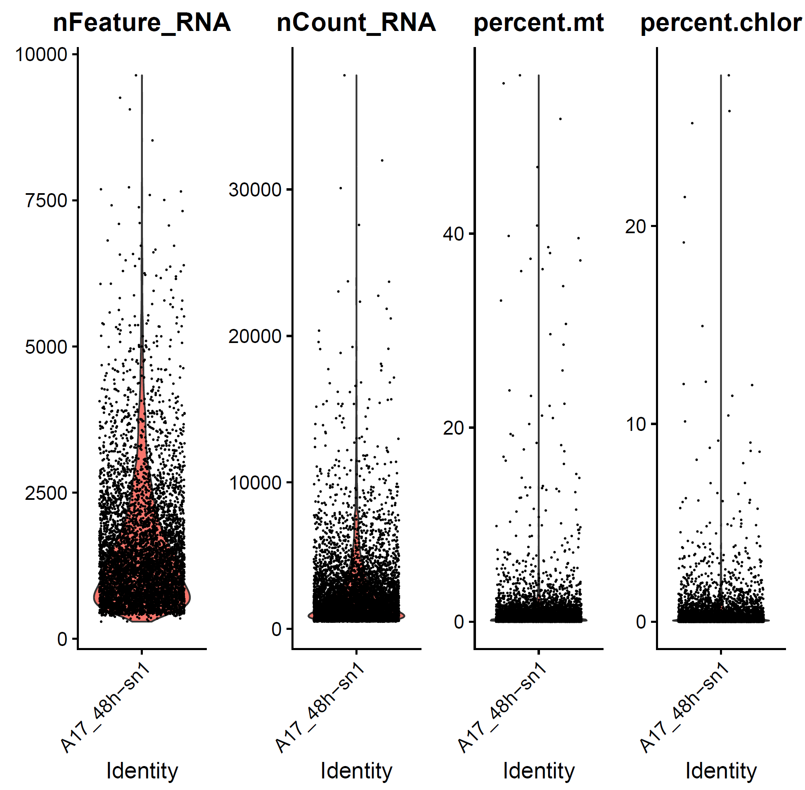
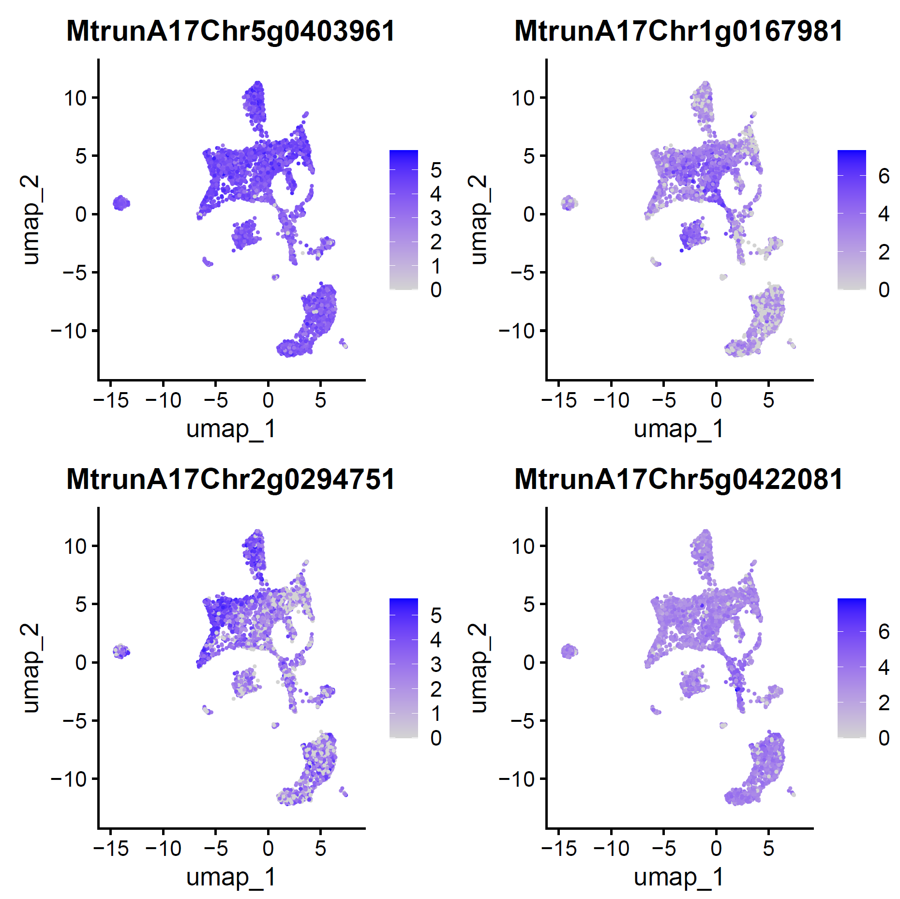
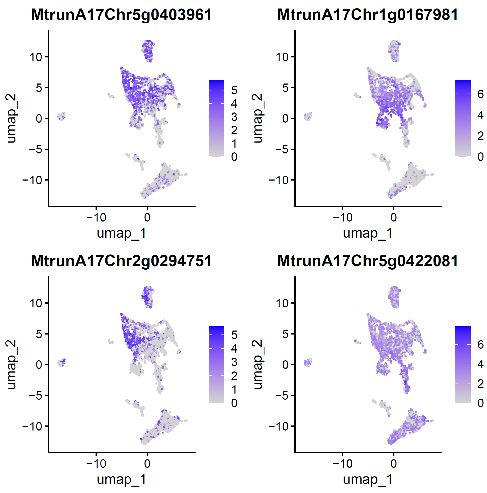
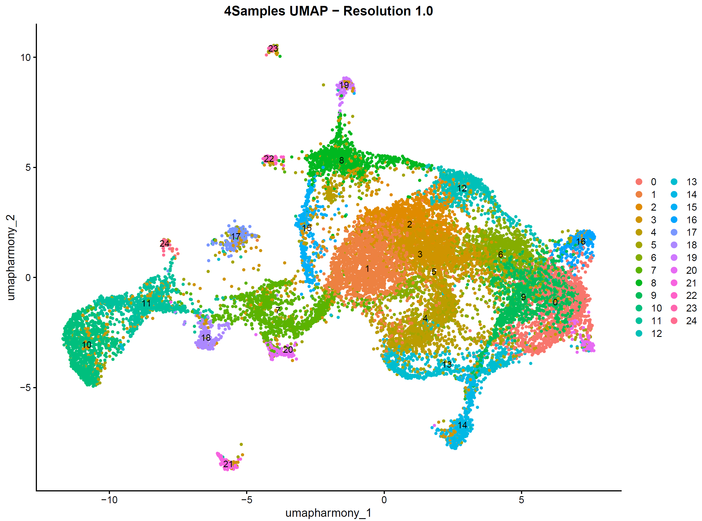
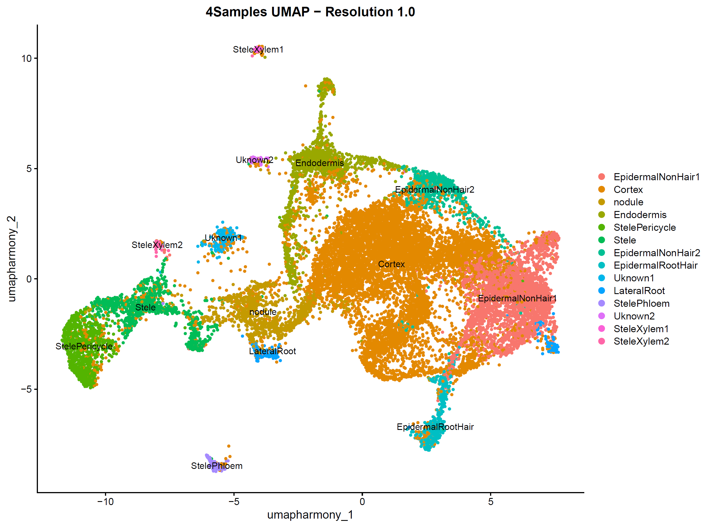

# Single-cell transcriptome analysis pipeline for Medicago truncatula, inoculated by rhizobium *E. meliloti*

### 0. Data Download

There are three sets of data. First one is singel-cell RNA-seq data from *Medicago truncatula* roots at the 0h, 24h, 48h and 96h after infection were downloaded from [PRJNA931615](https://www.ncbi.nlm.nih.gov/bioproject/PRJNA931615). And the second one is a single-nucleus RNA-seq dataset, from *M. truncatula* roots inoculated by rhizobium and sampled at 48h after infection. Third dataset is 14d after inoculation, downloaded from China National Genomics Data Center with BioProject number PRJCA012129 (https://doi.org/10.1016/j.molp.2022.10.021).

[Cervantes-Perez et al., 2022]: https://doi.org/10.1016/j.molp.2022.10.021    "Cell-specific pathways recruited for symbiotic nodulation in the Medicago truncatula legume. "

There are three replicates, the one with largest size was used, downloaded from [Gene expression profile at single cell level of Medicago truncatula roots in response to rhizobia infection (ID 868047) - BioProject - NCBI](https://www.ncbi.nlm.nih.gov/bioproject/PRJNA868047).

Following accession is for root1:

```bash
#!/bin/bash
#SBATCH --partition=icelake
#SBATCH -A EVESVANDENAKKER-SL2-CPU
#!SBATCH --partition=cclake,icelake,sapphire,icelake-himem,cclake-himem
#SBATCH --job-name=sra
#SBATCH --output=0.o
#SBATCH --error=0.e
#SBATCH --time=0-12:00:00
#SBATCH --nodes=1
#SBATCH --ntasks-per-node=1
#SBATCH --cpus-per-task=2
#SBATCH --mem=8000
#SBATCH --mail-type=ALL
#SBATCH --mail-user=cx264@cam.ac.uk

# note that fastereq-dump not works since technical reads are missing, so use fastq-dump
/rds/user/cx264/hpc-work/program/sratoolkit.3.0.10-centos_linux64/bin/fastq-dump --split-files --gzip SRR23341337
/rds/user/cx264/hpc-work/program/sratoolkit.3.0.10-centos_linux64/bin/prefetch SRR23341332 && /rds/user/cx264/hpc-work/program/sratoolkit.3.0.10-centos_linux64/bin/fasterq-dump SRR23341332 --split-files --bufsize 256MB --mem 4GB --outdir ./A17_48h
/rds/user/cx264/hpc-work/program/sratoolkit.3.0.10-centos_linux64/bin/prefetch SRR23341333 && /rds/user/cx264/hpc-work/program/sratoolkit.3.0.10-centos_linux64/bin/fasterq-dump SRR23341333 --split-files --bufsize 256MB --mem 4GB --outdir ./A17_48h
/rds/user/cx264/hpc-work/program/sratoolkit.3.0.10-centos_linux64/bin/fasterq-dump SRR23341332 --size-check off --threads 16 --bufsize 256MB --mem 4GB --outdir ./A17_48h
/rds/user/cx264/hpc-work/program/sratoolkit.3.0.10-centos_linux64/bin/fasterq-dump SRR23341333 --size-check off --threads 16 --bufsize 256MB --mem 4GB --outdir ./A17_48h

/rds/user/cx264/hpc-work/program/sratoolkit.3.0.10-centos_linux64/bin/prefetch SRR23341330 && /rds/user/cx264/hpc-work/program/sratoolkit.3.0.10-centos_linux64/bin/fasterq-dump SRR23341330 --split-files --size-check off --threads 16 --bufsize 256MB --mem 4GB --outdir ./A17_96h
/rds/user/cx264/hpc-work/program/sratoolkit.3.0.10-centos_linux64/bin/prefetch SRR23341331 && /rds/user/cx264/hpc-work/program/sratoolkit.3.0.10-centos_linux64/bin/fasterq-dump SRR23341331 --split-files --size-check off --threads 16 --bufsize 256MB --mem 4GB --outdir ./A17_96h

cd /rds-d7/user/cx264/rds-scrna_spatial-6qULnBz5AIM/Chongjing_Xia/01.SpatialTranscriptomics/01.Probe/01.CellReports/01.data/A17_48h.sn1

/rds/user/cx264/hpc-work/program/sratoolkit.3.0.10-centos_linux64/bin/prefetch SRR20997726 --max-size 50g
/rds/user/cx264/hpc-work/program/sratoolkit.3.0.10-centos_linux64/bin/fasterq-dump SRR20997726 --split-files --size-check off --threads 16 --bufsize 256MB --mem 4GB --outdir ./
#spots read      : 177,902,474
#reads read      : 533,707,422
#reads written   : 355,804,948
#technical reads : 177,902,474
```

Following two accessions are for root2

```bash
cd /rds-d7/user/cx264/rds-scrna_spatial-6qULnBz5AIM/Chongjing_Xia/01.SpatialTranscriptomics/01.Probe/01.CellReports/01.data/A17_48h.sn2
/rds/user/cx264/hpc-work/program/sratoolkit.3.0.10-centos_linux64/bin/prefetch SRR20997724 --max-size 50g
/rds/user/cx264/hpc-work/program/sratoolkit.3.0.10-centos_linux64/bin/fasterq-dump SRR20997724 --split-files --size-check off --threads 16 --bufsize 256MB --mem 4GB --outdir ./
#spots read      : 121,155,389
#reads read      : 363,466,167
#reads written   : 242,310,778
#technical reads : 121,155,389

/rds/user/cx264/hpc-work/program/sratoolkit.3.0.10-centos_linux64/bin/prefetch SRR20997725 --max-size 50g
/rds/user/cx264/hpc-work/program/sratoolkit.3.0.10-centos_linux64/bin/fasterq-dump SRR20997725 --split-files --size-check off --threads 16 --bufsize 256MB --mem 4GB --outdir ./
#spots read      : 120,990,879
#reads read      : 362,972,637
#reads written   : 241,981,758
#technical reads : 120,990,879
```

Following is for root3

```bash
cd /rds-d7/user/cx264/rds-scrna_spatial-6qULnBz5AIM/Chongjing_Xia/01.SpatialTranscriptomics/01.Probe/01.CellReports/01.data/A17_48h.sn3

/rds/user/cx264/hpc-work/program/sratoolkit.3.0.10-centos_linux64/bin/prefetch SRR20997723 --max-size 50g
/rds/user/cx264/hpc-work/program/sratoolkit.3.0.10-centos_linux64/bin/fasterq-dump SRR20997723 --split-files --size-check off --threads 16 --bufsize 256MB --mem 4GB --outdir ./
#spots read      : 187,024,121
#reads read      : 561,072,363
#reads written   : 374,048,242
#technical reads : 187,024,121
```

At this point, we need to re-name fastq files according to 10X, https://kb.10xgenomics.com/hc/en-us/articles/115003802691-How-do-I-prepare-Sequence-Read-Archive-SRA-data-from-NCBI-for-Cell-Ranger. What I do is to create softlinks:

```
ln -s SRR20997724_3.fastq A17_48h-sn2_S1_L001_R2_001.fastq
ln -s SRR20997724_2.fastq A17_48h-sn2_S1_L001_R1_001.fastq
ln -s SRR20997725_2.fastq A17_48h-sn2_S1_L002_R1_001.fastq
ln -s SRR20997725_3.fastq A17_48h-sn2_S1_L002_R2_001.fastq

ln -s SRR20997723_2.fastq A17_48h-sn3_S1_L001_R1_001.fastq
ln -s SRR20997723_3.fastq A17_48h-sn3_S1_L001_R2_001.fastq
```

### 1. Preprocessing using CellRanger

CellRanger v7.2.0 is used to get raw count matrix. Run CellRanger count for each sample.

```bash
cd /rds-d7/user/cx264/rds-scrna_spatial-6qULnBz5AIM/Chongjing_Xia/01.SpatialTranscriptomics/01.Probe/01.CellReports/02.CellRanger/A17_48h.sn1
export PATH=/rds/project/rds-FTKWLWDeHys/programs/CellRanger/cellranger-7.2.0/:$PATH

cellranger count --id A17-48h-sn1 --output-dir ./run1 --transcriptome /rds-d7/user/cx264/hpc-work/project/4.Giles/00.ref/M.truncatula_genome_v5/ --fastqs /rds-d7/user/cx264/rds-scrna_spatial-6qULnBz5AIM/Chongjing_Xia/01.SpatialTranscriptomics/01.Probe/01.CellReports/01.data/A17_48h.sn1/ --sample A17_48h-sn1
```

Here are some summary information from CellRanger count:

| Samples                                        |     | sn1         | sn2         | sn3         |
| ---------------------------------------------- | --- | ----------- | ----------- | ----------- |
| Estimated Number of Cells                      |     | 5,833       | 7,231       | 4,725       |
| Fraction Reads in Cells                        |     | 47.9%       | 66.6%       | 59.7%       |
| Mean Reads per Cell                            |     | 30,499      | 33,487      | 39,582      |
| Median UMI Counts per Cel                      |     | 1,730       | 734         | 2,024       |
| Median Genes per Cel                           |     | 1,249       | 592         | 1,377       |
| Total Genes Detected                           |     | 32,064      | 28,651      | 34,333      |
| Number of Reads                                |     | 177,902,474 | 242,146,268 | 187,024,121 |
| Reads Mapped to Genome                         |     | 96.4%       | 77.4%       | 91.2%       |
| Reads Mapped Confidently to Genome             |     | 68.7%       | 50.6%       | 52.6%       |
| Reads Mapped Confidently to Intergenic Regions |     | 1.8%        | 1.2%        | 1.6%        |
| Reads Mapped Confidently to Intronic Regions   |     | 14.0%       | 11.0%       | 12.0%       |
| Reads Mapped Confidently to Exonic Regions     |     | 52.9%       | 38.4%       | 39.0%       |
| Reads Mapped Confidently to Transcriptome      |     | 64.9%       | 48.3%       | 49.4%       |
| Reads Mapped Antisense to Gene                 |     | 2.0%        | 1.2%        | 1.6%        |

 Detailed summary is here [(https://github.com/chongjing/scRNAseq_Medicago/blob/main/01.CellRanger/)]. 

### 2. Quality Control

The following pipeline is to do Quality Control of single cell RNAseq data; de-contamination; and doublets removal. This should be done for each sample individually, here is example of A17_48-sn1. Cells that have unique feature counts over 2,500 or less than 200, and cells that have >5% mitochondrial/chloroplast counts, were filtered. 

#### 2.1 Processing sample A17_48h-sn1
```R
## modified from Seurat: https://satijalab.org/seurat/articles/pbmc3k_tutorial.html
##               scCDC:  https://htmlpreview.github.io/?https://github.com/ZJU-UoE-CCW-LAB/scCDC/blob/main/inst/doc/scCDC.html
##               scDblFinder: https://plger.github.io/scDblFinder/index.html

library(Seurat)
library(scCDC)
library(hdf5r)
library(Matrix)
library(scDblFinder)

## Step1: Prepare Seurat Object
print("Step1: Preparing Seurat Object")
# CellRanger processed matrix as input
filt.matrix <- Read10X_h5("/data/pathology/cxia/projects/Giles/Min-Yao/02.scRNAseq.QC/A17_48h-sn1/filtered_feature_bc_matrix.h5", use.names=T)
filt.matrix@Dimnames[[1]] <- gsub("_", "-", filt.matrix@Dimnames[[1]])
filt.matrix@Dimnames[[2]] <- gsub("_", "-", filt.matrix@Dimnames[[2]])

## Step2: Seurat quality control
print("Step2: Seurat Quality Control")
mislet_seuratobj <- CreateSeuratObject(counts = filt.matrix, project="A17_48h-sn1", min.cells = 3, min.features = 200)
print("Summary of Raw Matrix")
mislet_seuratobj
# An object of class Seurat
# 27968 features across 5833 samples within 1 assay
# Active assay: RNA (27968 features, 0 variable features)
# 1 layer present: counts

mislet_seuratobj[["percent.mt"]] <- PercentageFeatureSet(mislet_seuratobj, pattern = "^MtrunA17MTg")
print("Percentage of Mitochondrial reads")
sum(mislet_seuratobj@meta.data$percent.mt)
# [1] 5425.769
mislet_seuratobj[["percent.chlor"]] <- PercentageFeatureSet(mislet_seuratobj, pattern = "^MtrunA17CPg")
print("Percentage of Chloroplast reads")
sum(mislet_seuratobj@meta.data$percent.chlor)
# [1] 2109.06
pdf("02.QC_mt_chlor.pdf")
VlnPlot(mislet_seuratobj, features = c("nFeature_RNA", "nCount_RNA", "percent.mt", "percent.chlor"), ncol = 4)
dev.off()
```
Here is a plot of percentage of mitochondrial and chloroplast reads in the sample.

```R
# cells that have unique feature counts over 2,500 or less than 200, and cells that have >5% mitochondrial/chloroplast counts, were filtered.
mislet_seuratobj <- subset(mislet_seuratobj, subset = nFeature_RNA > 200 & nFeature_RNA < 2500 & percent.mt < 5 & percent.chlor <5)
print("Summary of Filtered Matrix")
mislet_seuratobj
# An object of class Seurat
# 27968 features across 4881 samples within 1 assay
# Active assay: RNA (27968 features, 0 variable features)
# 1 layer present: counts

## Step3: Seurat Normalization and PCA
mislet_seuratobj <- NormalizeData(mislet_seuratobj, normalization.method = "LogNormalize",scale.factor = 10000)
mislet_seuratobj <- FindVariableFeatures(mislet_seuratobj, selection.method = "vst", nfeatures = 2000)
all.genes <- rownames(mislet_seuratobj)
mislet_seuratobj <- ScaleData(mislet_seuratobj, features = all.genes)
mislet_seuratobj <- RunPCA(mislet_seuratobj,
                    features = VariableFeatures(object = mislet_seuratobj))
pdf("03.PCA.pdf")
ElbowPlot(mislet_seuratobj)
DimPlot(mislet_seuratobj, reduction = "pca") + NoLegend()
DimHeatmap(mislet_seuratobj, dims = 1:15, cells = 500, balanced = TRUE)

## Step4: Seurat Clustering
mislet_seuratobj <- FindNeighbors(mislet_seuratobj, dims = 1:20)
mislet_seuratobj <- FindClusters(mislet_seuratobj, resolution = 0.6)
mislet_seuratobj <- RunUMAP(mislet_seuratobj, dims = 1:20)
DimPlot(mislet_seuratobj, reduction = "umap")
dev.off()

## Step5: Contamination Detection
print("Step5: Contamination Detection")
#subset_cells <- sample(colnames(mislet_seuratobj), size = 8000)
#mislet_seuratobj_subset <- subset(mislet_seuratobj, cells = subset_cells)
GCGs <- ContaminationDetection(mislet_seuratobj,restriction_factor = 0.5,
                                        sample_name = "A17_48h-sn1",out_path.plot = "./", out_path.table = "./")
GCGs
mislet_cont_ratio <- ContaminationQuantification(mislet_seuratobj,rownames(GCGs))
# The maximum contamination ratio is:0.00628, which indicates high contamination in this dataset. scCDC is highly recommended to be applied.
mislet_seuratobj_corrected <- ContaminationCorrection(mislet_seuratobj, rownames(GCGs))

## Step6: Save scCDC-Corrected Matrix
DefaultAssay(mislet_seuratobj_corrected) <- "Corrected"
saveRDS(mislet_seuratobj_corrected, file = "04.A17_48h-sn1_seuratobj_corrected.rds")


# Seurat Analysis on Corrected Matrix
DefaultAssay(mislet_seuratobj_corrected) <- "Corrected"
mislet_seuratobj_corrected <- NormalizeData(mislet_seuratobj_corrected, normalization.method = "LogNormalize",scale.factor = 10000)
mislet_seuratobj_corrected <- FindVariableFeatures(mislet_seuratobj_corrected, selection.method = "vst", nfeatures = 2000)
all.genes <- rownames(mislet_seuratobj_corrected)
mislet_seuratobj_corrected <- ScaleData(mislet_seuratobj_corrected, features = all.genes)
mislet_seuratobj_corrected <- RunPCA(mislet_seuratobj_corrected,
                                features = VariableFeatures(object = mislet_seuratobj_corrected))
mislet_seuratobj_corrected <- FindNeighbors(mislet_seuratobj_corrected, dims = 1:15)
mislet_seuratobj_corrected <- FindClusters(mislet_seuratobj_corrected, resolution = 0.2,verbose = F)
mislet_seuratobj_corrected <- RunUMAP(mislet_seuratobj_corrected,dims=1:15)

# Visualization
svg("05.A17_48h-sn1.decontamination.svg")
ElbowPlot(mislet_seuratobj_corrected)
FeaturePlot(mislet_seuratobj, features = c(rownames(GCGs)[1], rownames(GCGs)[2], rownames(GCGs)[3], rownames(GCGs)[4]))
FeaturePlot(mislet_seuratobj_corrected, features = c(rownames(GCGs)[1], rownames(GCGs)[2], rownames(GCGs)[3], rownames(GCGs)[4]))
dev.off()
pdf("05.A17_48h-sn1.decontamination.pdf")
ElbowPlot(mislet_seuratobj_corrected)
FeaturePlot(mislet_seuratobj, features = c(rownames(GCGs)[1], rownames(GCGs)[2], rownames(GCGs)[3], rownames(GCGs)[4]))
FeaturePlot(mislet_seuratobj_corrected, features = c(rownames(GCGs)[1], rownames(GCGs)[2], rownames(GCGs)[3], rownames(GCGs)[4]))
dev.off()
```
Here is a visualization of several contamination-causing genes (GCGs), before and after decontamination.
<table>
  <tr>
    <td></td>
    <td></td>
  </tr>
</table>

```R
## Step7: scDblFinder remove doublets
print("Step7: scDblFinder remove doublets")
DefaultAssay(mislet_seuratobj_corrected) <- "Corrected"
sce <- as.SingleCellExperiment(mislet_seuratobj_corrected)
sce <- scDblFinder(sce)
# 447 (9.2%) doublets called
# After running scDblFinder, you can analyze the results. The doublet scores and classifications will be added to the colData of the SCE object:
doublet_scores <- colData(sce)$scDblFinder.score
doublet_classifications <- colData(sce)$scDblFinder.class
# Convert Back to Seurat: If you need to convert the SCE object back to a Seurat object:
seurat_obj <- as.Seurat(sce)
seurat_obj_singlets <- subset(seurat_obj, subset = scDblFinder.class == "singlet")
saveRDS(seurat_obj_singlets, file = "06.A17_48h-sn1_scCDC_scDblFinder_corrected.rds")
# Verify the filtering
table(seurat_obj_singlets$scDblFinder.class)
# singlet doublet
#   4434       0

print("ANALYSIS DONE")

> sessionInfo()
R version 4.4.1 (2024-06-14)
Platform: x86_64-conda-linux-gnu
Running under: Debian GNU/Linux 11 (bullseye)

Matrix products: default
BLAS/LAPACK: /data/pathology/program/Miniforge3/envs/R4.2.3/lib/libopenblasp-r0.3.27.so;  LAPACK version 3.12.0

locale:
 [1] LC_CTYPE=en_GB.UTF-8       LC_NUMERIC=C
 [3] LC_TIME=en_GB.UTF-8        LC_COLLATE=en_GB.UTF-8
 [5] LC_MONETARY=en_GB.UTF-8    LC_MESSAGES=en_GB.UTF-8
 [7] LC_PAPER=en_GB.UTF-8       LC_NAME=C
 [9] LC_ADDRESS=C               LC_TELEPHONE=C
[11] LC_MEASUREMENT=en_GB.UTF-8 LC_IDENTIFICATION=C

time zone: Europe/London
tzcode source: system (glibc)

attached base packages:
[1] stats4    stats     graphics  grDevices utils     datasets  methods
[8] base

other attached packages:
 [1] scDblFinder_1.18.0          SingleCellExperiment_1.26.0
 [3] SummarizedExperiment_1.34.0 Biobase_2.64.0
 [5] GenomicRanges_1.56.1        GenomeInfoDb_1.40.1
 [7] IRanges_2.38.1              S4Vectors_0.42.1
 [9] BiocGenerics_0.50.0         MatrixGenerics_1.16.0
[11] matrixStats_1.4.1           hdf5r_1.3.11
[13] scCDC_1.4                   tidyr_1.3.1
[15] knitr_1.48                  pROC_1.18.5
[17] Matrix_1.7-0                ggrepel_0.9.6
[19] pbapply_1.7-2               ggplot2_3.5.1
[21] dplyr_1.1.4                 ddpcr_1.15.2
[23] Seurat_5.1.0                SeuratObject_5.0.2
[25] sp_2.1-4

loaded via a namespace (and not attached):
  [1] RcppAnnoy_0.0.22          splines_4.4.1
  [3] later_1.3.2               BiocIO_1.14.0
  [5] bitops_1.0-8              tibble_3.2.1
  [7] polyclip_1.10-7           XML_3.99-0.17
  [9] fastDummies_1.7.4         lifecycle_1.0.4
 [11] edgeR_4.2.1               globals_0.16.3
 [13] lattice_0.22-6            MASS_7.3-61
 [15] magrittr_2.0.3            limma_3.60.4
 [17] plotly_4.10.4             yaml_2.3.10
 [19] metapod_1.12.0            httpuv_1.6.15
 [21] sctransform_0.4.1         spam_2.10-0
 [23] spatstat.sparse_3.1-0     reticulate_1.39.0
 [25] cowplot_1.1.3             RColorBrewer_1.1-3
 [27] abind_1.4-8               zlibbioc_1.50.0
 [29] Rtsne_0.17                purrr_1.0.2
 [31] RCurl_1.98-1.16           GenomeInfoDbData_1.2.12
 [33] irlba_2.3.5.1             listenv_0.9.1
 [35] spatstat.utils_3.1-0      goftest_1.2-3
 [37] RSpectra_0.16-2           dqrng_0.4.1
 [39] spatstat.random_3.3-2     fitdistrplus_1.2-1
 [41] parallelly_1.38.0         DelayedMatrixStats_1.26.0
 [43] leiden_0.4.3.1            codetools_0.2-20
 [45] DelayedArray_0.30.1       scuttle_1.14.0
 [47] tidyselect_1.2.1          UCSC.utils_1.0.0
 [49] farver_2.1.2              viridis_0.6.5
 [51] ScaledMatrix_1.12.0       spatstat.explore_3.3-2
 [53] GenomicAlignments_1.40.0  jsonlite_1.8.9
 [55] BiocNeighbors_1.22.0      progressr_0.14.0
 [57] scater_1.32.1             ggridges_0.5.6
 [59] survival_3.7-0            tools_4.4.1
 [61] ica_1.0-3                 Rcpp_1.0.13
 [63] glue_1.7.0                gridExtra_2.3
 [65] SparseArray_1.4.8         xfun_0.47
 [67] withr_3.0.1               fastmap_1.2.0
 [69] bluster_1.14.0            fansi_1.0.6
 [71] digest_0.6.37             rsvd_1.0.5
 [73] R6_2.5.1                  mime_0.12
 [75] colorspace_2.1-1          scattermore_1.2
 [77] tensor_1.5                spatstat.data_3.1-2
 [79] utf8_1.2.4                generics_0.1.3
 [81] data.table_1.16.0         rtracklayer_1.64.0
 [83] httr_1.4.7                htmlwidgets_1.6.4
 [85] S4Arrays_1.4.1            uwot_0.2.2
 [87] pkgconfig_2.0.3           gtable_0.3.5
 [89] lmtest_0.9-40             XVector_0.44.0
 [91] htmltools_0.5.8.1         dotCall64_1.1-1
 [93] scales_1.3.0              png_0.1-8
 [95] spatstat.univar_3.0-1     scran_1.32.0
 [97] reshape2_1.4.4            rjson_0.2.23
 [99] nlme_3.1-166              curl_5.2.1
[101] zoo_1.8-12                stringr_1.5.1
[103] KernSmooth_2.23-24        vipor_0.4.7
[105] parallel_4.4.1            miniUI_0.1.1.1
[107] restfulr_0.0.15           pillar_1.9.0
[109] grid_4.4.1                vctrs_0.6.5
[111] RANN_2.6.2                promises_1.3.0
[113] BiocSingular_1.20.0       beachmat_2.20.0
[115] xtable_1.8-4              cluster_2.1.6
[117] beeswarm_0.4.0            locfit_1.5-9.10
[119] cli_3.6.3                 compiler_4.4.1
[121] Rsamtools_2.20.0          rlang_1.1.4
[123] crayon_1.5.3              future.apply_1.11.2
[125] ggbeeswarm_0.7.2          plyr_1.8.9
[127] stringi_1.8.4             viridisLite_0.4.2
[129] deldir_2.0-4              BiocParallel_1.38.0
[131] munsell_0.5.1             Biostrings_2.72.1
[133] lazyeval_0.2.2            spatstat.geom_3.3-3
[135] RcppHNSW_0.6.0            patchwork_1.3.0
[137] sparseMatrixStats_1.16.0  bit64_4.5.2
[139] future_1.34.0             statmod_1.5.0
[141] shiny_1.9.1               ROCR_1.0-11
[143] igraph_2.0.3              xgboost_1.7.8.1
[145] bit_4.5.0
```

#### 2.2 Processing two samples of A17_14d

```R
##### aggregate CRR574231 and CRR574232 as A17_14d, and quality control #####
cd /data/pathology/cxia/projects/Giles/Min-Yao/02.scRNAseq.QC/A17_14d
library(Seurat)
library(scCDC)
library(hdf5r)
library(Matrix)
library(scDblFinder)

## Step0: Aggregation
##### run cellrange aggr to aggrate all six samples
cd /data/pathology/cxia/projects/Giles/Min-Yao/02.scRNAseq.QC/A17_14d/
cellranger aggr --id=14d --csv 0.SixSamples.csv

#####0.SixSamples.csv
sample_id,molecule_h5
CRR574231,/rds-d7/user/cx264/hpc-work/project/4.Giles/01.Min-Yao/01.CellReports/02.CellRanger/CRR574231/run1/outs/molecule_info.h5
CRR574232,/rds-d7/user/cx264/hpc-work/project/4.Giles/01.Min-Yao/01.CellReports/02.CellRanger/CRR574232/run1/outs/molecule_info.h5

## Step1: Prepare Seurat Object
print("Step1: Preparing Seurat Object")
#filt.matrix <- Read10X_h5("/data/pathology/cxia/projects/Giles/Min-Yao/02.scRNAseq.QC/A17_14d/filtered_feature_bc_matrix.h5", use.names=T)
#filt.matrix@Dimnames[[1]] <- gsub("_", "-", filt.matrix@Dimnames[[1]])
#filt.matrix@Dimnames[[2]] <- gsub("_", "-", filt.matrix@Dimnames[[2]])

## Step2: Seurat quality control
print("Step2: Seurat Quality Control")
#mislet_seuratobj <- CreateSeuratObject(counts = filt.matrix, project="A17_14d", min.cells = 3, min.features = 200)

mislet_seuratobj <- readRDS("00.A17_14dpi.rds")
print("data struction before JoinLayers")
str(mislet_seuratobj)
mislet_seuratobj <- JoinLayers(mislet_seuratobj)
print("data struction after JoinLayers")
str(mislet_seuratobj)
print("Summary of Raw Matrix")
mislet_seuratobj
mislet_seuratobj[["percent.mt"]] <- PercentageFeatureSet(mislet_seuratobj, pattern = "^MtrunA17MTg")
print("Percentage of Mitochondrial reads")
sum(mislet_seuratobj@meta.data$percent.mt)
mislet_seuratobj[["percent.chlor"]] <- PercentageFeatureSet(mislet_seuratobj, pattern = "^MtrunA17CPg")
print("Percentage of Chloroplast reads")
sum(mislet_seuratobj@meta.data$percent.chlor)
pdf("02.QC_mt_chlor.pdf")
VlnPlot(mislet_seuratobj, features = c("nFeature_RNA", "nCount_RNA", "percent.mt", "percent.chlor"), ncol = 4)
dev.off()
mislet_seuratobj <- subset(mislet_seuratobj, subset = nFeature_RNA > 200 & nFeature_RNA < 2500 & percent.mt < 5 & percent.chlor <5)
print("Summary of Filtered Matrix")
mislet_seuratobj

## Step3: Seurat Normalization and PCA
mislet_seuratobj <- NormalizeData(mislet_seuratobj, normalization.method = "LogNormalize",scale.factor = 10000)
mislet_seuratobj <- FindVariableFeatures(mislet_seuratobj, selection.method = "vst", nfeatures = 2000)
all.genes <- rownames(mislet_seuratobj)
mislet_seuratobj <- ScaleData(mislet_seuratobj, features = all.genes)
mislet_seuratobj <- RunPCA(mislet_seuratobj,
                                features = VariableFeatures(object = mislet_seuratobj))
pdf("03.PCA.pdf")
ElbowPlot(mislet_seuratobj)
DimPlot(mislet_seuratobj, reduction = "pca") + NoLegend()
DimHeatmap(mislet_seuratobj, dims = 1:15, cells = 500, balanced = TRUE)

## Step4: Seurat Clustering
mislet_seuratobj <- FindNeighbors(mislet_seuratobj, dims = 1:20)
mislet_seuratobj <- FindClusters(mislet_seuratobj, resolution = 0.6)
mislet_seuratobj <- RunUMAP(mislet_seuratobj, dims = 1:20)
DimPlot(mislet_seuratobj, reduction = "umap")
dev.off()

## Step5: Contamination Detection
print("Step5: Contamination Detection")
#subset_cells <- sample(colnames(mislet_seuratobj), size = 8000)
#mislet_seuratobj_subset <- subset(mislet_seuratobj, cells = subset_cells)
GCGs <- ContaminationDetection(mislet_seuratobj,restriction_factor = 0.5,
                                        sample_name = "A17_14d",out_path.plot = "./",
                                        out_path.table = "./")
GCGs
mislet_cont_ratio <- ContaminationQuantification(mislet_seuratobj,rownames(GCGs))
mislet_seuratobj_corrected <- ContaminationCorrection(mislet_seuratobj, rownames(GCGs))

## Step6: Save scCDC-Corrected Matrix
DefaultAssay(mislet_seuratobj_corrected) <- "Corrected"
saveRDS(mislet_seuratobj_corrected, file = "04.A17_14d_seuratobj_corrected.rds")


# Seurat Analysis on Corrected Matrix
DefaultAssay(mislet_seuratobj_corrected) <- "Corrected"
mislet_seuratobj_corrected <- NormalizeData(mislet_seuratobj_corrected, normalization.method = "LogNormalize",scale.factor = 10000)
mislet_seuratobj_corrected <- FindVariableFeatures(mislet_seuratobj_corrected, selection.method = "vst", nfeatures = 2000)
all.genes <- rownames(mislet_seuratobj_corrected)
mislet_seuratobj_corrected <- ScaleData(mislet_seuratobj_corrected, features = all.genes)
mislet_seuratobj_corrected <- RunPCA(mislet_seuratobj_corrected,
                                features = VariableFeatures(object = mislet_seuratobj_corrected))
mislet_seuratobj_corrected <- FindNeighbors(mislet_seuratobj_corrected, dims = 1:15)
mislet_seuratobj_corrected <- FindClusters(mislet_seuratobj_corrected, resolution = 0.2,verbose = F)
mislet_seuratobj_corrected <- RunUMAP(mislet_seuratobj_corrected,dims=1:15)

# Visualization
svg("05.A17_14d.decontamination.svg")
ElbowPlot(mislet_seuratobj_corrected)
FeaturePlot(mislet_seuratobj, features = c(rownames(GCGs)[1], rownames(GCGs)[2], rownames(GCGs)[3], rownames(GCGs)[4]))
FeaturePlot(mislet_seuratobj_corrected, features = c(rownames(GCGs)[1], rownames(GCGs)[2], rownames(GCGs)[3], rownames(GCGs)[4]))
dev.off()
pdf("05.A17_14d.decontamination.pdf")
ElbowPlot(mislet_seuratobj_corrected)
FeaturePlot(mislet_seuratobj, features = c(rownames(GCGs)[1], rownames(GCGs)[2], rownames(GCGs)[3], rownames(GCGs)[4]))
FeaturePlot(mislet_seuratobj_corrected, features = c(rownames(GCGs)[1], rownames(GCGs)[2], rownames(GCGs)[3], rownames(GCGs)[4]))
dev.off()

## Step7: scDblFinder remove doublets
print("Step7: scDblFinder remove doublets")
DefaultAssay(mislet_seuratobj_corrected) <- "Corrected"
sce <- as.SingleCellExperiment(mislet_seuratobj_corrected)
sce <- scDblFinder(sce)
# After running scDblFinder, you can analyze the results. The doublet scores and classifications will be added to the colData of the SCE object:
doublet_scores <- colData(sce)$scDblFinder.score
doublet_classifications <- colData(sce)$scDblFinder.class
# Convert Back to Seurat: If you need to convert the SCE object back to a Seurat object:
seurat_obj <- as.Seurat(sce)
seurat_obj_singlets <- subset(seurat_obj, subset = scDblFinder.class == "singlet")
saveRDS(seurat_obj_singlets, file = "06.A17_14d_scCDC_scDblFinder_corrected.rds")
# Verify the filtering
table(seurat_obj_singlets$scDblFinder.class)

print("ANALYSIS DONE")
```

Results of Quality Control of all samples could be found here [scRNAseq_Medicago/02.QualityControl at main · chongjing/scRNAseq_Medicago](https://github.com/chongjing/scRNAseq_Medicago/tree/main/02.QualityControl) .

### 3. Integration and Annotation
Since 14d samples have distinct features, we plan to integrate 0h, 24h, 48h, 96h together, using all genes and 480 genes.

#### 3.1 Integration of four samples of 0h, 24h, 48h, 96h using all genes
```bash
cd /home/cx264/project/Giles/Min-Yao/011.Integration4snRNAseq
conda activate R4.2.3_old
/home/cx264/program/anaconda3/envs/R4.2.3_old/bin/R
```

```r
library(Seurat)
library(harmony)
library(SeuratWrappers)
library(sceasy)
library(batchelor)
## merge all samples together, each sample as one assay in Seurat Object
# Step1: import Seurat objects for each sample
# these seurat objects are scCDC and scDblFinder processed matrix
A17_0h <- readRDS("../02.scRNAseq.QC/A17_0h/06.A17_0h_scCDC_scDblFinder_corrected.rds")
A17_24h <- readRDS("../02.scRNAseq.QC/A17_24h/06.A17_24h_scCDC_scDblFinder_corrected.rds")
A17_48h <- readRDS("../02.scRNAseq.QC/A17_48h/06.A17_48h_scCDC_scDblFinder_corrected.rds")
A17_96h <- readRDS("../02.scRNAseq.QC/A17_96h/06.A17_96h_scCDC_scDblFinder_corrected.rds")

# Step2: create a new Seurat object for combined samples
# 2.1. get all genes
rownames_list <- list(
  rownames(A17_0h@assays$Corrected@counts),
  rownames(A17_24h@assays$Corrected@counts),
  rownames(A17_48h@assays$Corrected@counts),
  rownames(A17_96h@assays$Corrected@counts)
)
all_genes <- Reduce(union, rownames_list)
# re-name each cell with sample names
colnames_list <- list(
  paste("A17_0h", colnames(A17_0h@assays$Corrected@counts), sep = "_"),
  paste("A17_24h", colnames(A17_24h@assays$Corrected@counts), sep = "_"),
  paste("A17_48h", colnames(A17_48h@assays$Corrected@counts), sep = "_"),
  paste("A17_96h", colnames(A17_96h@assays$Corrected@counts), sep = "_")
)
all_cells <- unlist(colnames_list)
# 2.2. create matrix with all genes and all cells, filling with zeros
new_counts_matrix <- matrix(0, nrow = length(all_genes), ncol = length(all_cells), dimnames = list(all_genes,all_cells))
# 2.3. create new Seurat object, with all genes and A17_0h counts
all_sample_SeuratObj <- CreateSeuratObject(counts=new_counts_matrix)
# Step2: add eash sample as layers
colnames(A17_0h@assays$Corrected@counts) <- paste("A17_0h", colnames(A17_0h@assays$Corrected@counts), sep = "_")
colnames(A17_24h@assays$Corrected@counts) <- paste("A17_24h", colnames(A17_24h@assays$Corrected@counts), sep = "_")
colnames(A17_48h@assays$Corrected@counts) <- paste("A17_48h", colnames(A17_48h@assays$Corrected@counts), sep = "_")
colnames(A17_96h@assays$Corrected@counts) <- paste("A17_96h", colnames(A17_96h@assays$Corrected@counts), sep = "_")

all_sample_SeuratObj[["RNA"]]$counts.A17_0h <- A17_0h@assays$Corrected@counts
all_sample_SeuratObj[["RNA"]]$counts.A17_24h <- A17_24h@assays$Corrected@counts
all_sample_SeuratObj[["RNA"]]$counts.A17_48h <- A17_48h@assays$Corrected@counts
all_sample_SeuratObj[["RNA"]]$counts.A17_96h <- A17_96h@assays$Corrected@counts

# Step3: remove original counts layer in RNA assay with all zeros
all_sample_SeuratObj[["RNA"]]$counts <- NULL
# add Sample names to meta.data, these numbers are number of cells in each sample
sample_names <- c(
  rep("A17_0h", 3933),
  rep("A17_24h", 3201),
  rep("A17_48h", 4465),
  rep("A17_96h", 6745)
)
all_sample_SeuratObj@meta.data$Sample <- sample_names
all_sample_SeuratObj
#An object of class Seurat
#27698 features across 18344 samples within 1 assay
#Active assay: RNA (27698 features, 0 variable features)
# 4 layers present: counts.A17_0h, counts.A17_24h, counts.A17_48h, counts.A17_96h

# Step4: Seurat Integration, following https://satijalab.org/seurat/articles/seurat5_integration
all_sample_SeuratObj <- NormalizeData(all_sample_SeuratObj)
all_sample_SeuratObj <- FindVariableFeatures(all_sample_SeuratObj)
all_sample_SeuratObj <- ScaleData(all_sample_SeuratObj)
all_sample_SeuratObj <- RunPCA(all_sample_SeuratObj)
# 4.1. visualize the results of a standard analysis without integration.
all_sample_SeuratObj <- FindNeighbors(all_sample_SeuratObj, dims = 1:30, reduction = "pca")
all_sample_SeuratObj <- FindClusters(all_sample_SeuratObj, resolution = c(0.2, 0.4, 0.6, 0.8, 1.0, 1.2))
all_sample_SeuratObj <- RunUMAP(all_sample_SeuratObj, dims = 1:30, reduction = "pca", reduction.name = "umap.unintegrated")
all_sample_SeuratObj <- RunTSNE(all_sample_SeuratObj, dims = 1:30, perplexity = 30, reduction.name = "tsne.unintegrated")

# visualize by batch (sample)
pdf("001.sample.effect.UMAP.pdf")
DimPlot(all_sample_SeuratObj, reduction = "umap.unintegrated", group.by = "Sample")
DimPlot(all_sample_SeuratObj, reduction = "tsne.unintegrated", group.by = "Sample")
dev.off()

# 4.2 Integration using scVI
all_sample_SeuratObj <- IntegrateLayers(
  object = all_sample_SeuratObj, method = scVIIntegration,
  new.reduction = "integrated.scvi",
  conda_env = "/data/pathology/program/Miniforge3/envs/R4.2.3", verbose = FALSE
)
# 4.3. Integration using Harmony
all_sample_SeuratObj <- IntegrateLayers(
  object = all_sample_SeuratObj, method = HarmonyIntegration,
  orig.reduction="pca", new.reduction = "harmony", verbose = FALSE
)
all_sample_SeuratObj <- FindNeighbors(all_sample_SeuratObj, reduction = "harmony", dims = 1:30)
all_sample_SeuratObj <- FindClusters(all_sample_SeuratObj, resolution = c(0.2, 0.4, 0.6, 0.8, 1.0, 1.2), cluster.name = "harmony_clusters")
all_sample_SeuratObj <- RunUMAP(all_sample_SeuratObj, reduction = "harmony", dims = 1:30, reduction.name = "umap.harmony")
all_sample_SeuratObj <- RunTSNE(all_sample_SeuratObj, reduction = "harmony", dims = 1:30, perplexity = 30, reduction.name = "tsne.harmony")

pdf("02.sample.effect.UMAP-harmony-integrated.pdf")
DimPlot(all_sample_SeuratObj, reduction = "umap.unintegrated", group.by = "Sample")
DimPlot(all_sample_SeuratObj, reduction = "umap.harmony", group.by = "Sample")
dev.off()
```
Visualization of batch effects, UMAP of before and after harmony integration.
<table>
  <tr>
    <td></td>
    <td></td>
  </tr>
</table>

```R
all_sample_SeuratObj <- JoinLayers(all_sample_SeuratObj)
all_sample_SeuratObj
#An object of class Seurat
#27698 features across 18344 samples within 1 assay
#Active assay: RNA (27698 features, 2000 variable features)
# 3 layers present: data, counts, scale.data
# 6 dimensional reductions calculated: pca, umap.unintegrated, tsne.unintegrated, harmony, umap.harmony, tsne.harmony

saveRDS(all_sample_SeuratObj, file="03.harmony-integrated.4Samples.rds")

## plot all resolutions UMAP
library(ggplot2)
resolutions <- c(0.2, 0.4, 0.6, 0.8, 1.0, 1.2)
cluster_prefix <- paste0(all_sample_SeuratObj@active.assay, "_snn_res.")
pdf("03.4Samples.MultiRes_UMAP_tSNE.pdf")  # Adjust size as needed
for (res in resolutions) {
  cluster_col <- paste0(cluster_prefix, res)  # e.g., "Corrected_snn_res.0.2"
  
  # Plot UMAP for this resolution
  p1 <- DimPlot(all_sample_SeuratObj, reduction = "umap.harmony", group.by = cluster_col, label = TRUE) +
       ggtitle(paste("4 samples UMAP - Resolution", res))
  print(p1)  # Print to PDF device
  p2 <- DimPlot(all_sample_SeuratObj, reduction = "tsne.harmony", group.by = cluster_col, label = TRUE) +
       ggtitle(paste("4 samples tSNE - Resolution", res))
  print(p2)
}
dev.off()
## Use clustree package for a tree visualization to compare stability across resolutions
library(clustree)
pdf("04.4Samples.clustree.pdf")
clustree(all_sample_SeuratObj, prefix = "RNA_snn_res.")
dev.off()
```
Cluster tree and DimPlot at multiple resolutions can be used to determine best resolution.
<table>
  <tr>
    <td></td>
    <td></td>
  </tr>
  <tr>
    <td></td>
    <td></td>
  </tr>
</table>

```R
## Once decided, set it as the default:
all_sample_SeuratObj$seurat_clusters <- all_sample_SeuratObj$RNA_snn_res.1
Idents(all_sample_SeuratObj) <- "seurat_clusters"

saveRDS(all_sample_SeuratObj, file="05.4Samples.Harmony.MultiRes0.2-1.2_UMAP_tSNE.rds")


###########################
### Find DEG markers ###
###########################
AllMarkers <- FindAllMarkers(all_sample_SeuratObj, only.pos = TRUE)
saveRDS(AllMarkers, file = "06.4Samples.Harmony.Res1.0_markers.rds")
write.table(AllMarkers, file = "06.4Samples.Harmony.Res1.0_markers.tsv", sep = "\t", quote = FALSE, row.names = FALSE)

#############################
#### Annotation 20251208 ####
#############################
all_sample_SeuratObj <- readRDS("05.4Samples.Harmony.MultiRes0.2-1.2_UMAP_tSNE.rds")

## to plot heatmap of marker genes
cluster_markers <- as.list(readLines("../005.Annotation5snRNAseq/2.A17_96h/02.default/01.ClusterMarkers.list"))
cluster_markers <- unlist(cluster_markers)
cluster_prefix <- paste0(all_sample_SeuratObj@active.assay, "_snn_res.")
library(ggplot2)
pdf("07.4Sample.MultiRes_DotPlots.pdf", 18, 9)
resolutions <- c(0.8, 1.0, 1.2)
for (res in resolutions) {
  Idents(all_sample_SeuratObj) <- paste0(cluster_prefix, res)
  p <- DotPlot(all_sample_SeuratObj, features = cluster_markers) + 
        ggtitle(paste("Marker Res", res)) +
        theme(axis.text.x = element_text(angle = 45, hjust = 1))
  print(p)
}
dev.off()
```
Note that, 119 marker genes from rpreviously published study were used to check their expression  .
Here is the DotPlot of these marker genes in our cluster at resolution 1.0
[marker genes](https://github.com/chongjing/scRNAseq_Medicago/blob/main/011.Integration4snRNAseq/07.4Sample.MultiRes_DotPlots.jpeg)

```R
# Define new cluster labels
Idents(all_sample_SeuratObj) <- all_sample_SeuratObj$RNA_snn_res.1
new.cluster.ids <- c("EpidermalNonHair1","Cortex","Cortex","Cortex","Cortex","Cortex","Cortex","nodule","Endodermis",
"EpidermalNonHair1","StelePericycle","Stele","EpidermalNonHair2","Cortex","EpidermalRootHair","Endodermis","EpidermalNonHair1","Uknown1","Stele","Endodermis","LateralRoot","StelePhloem","Uknown2","SteleXylem1","SteleXylem2")
names(new.cluster.ids) <- levels(Idents(all_sample_SeuratObj))  # Set names to current levels
# Rename Idents
all_sample_SeuratObj <- RenameIdents(all_sample_SeuratObj, new.cluster.ids)

# add annotation as new column
all_sample_SeuratObj$annotated_clusters <- Idents(all_sample_SeuratObj)
# Optionally update seurat_clusters for metadata consistency
# all_sample_SeuratObj$seurat_clusters <- Idents(all_sample_SeuratObj)

saveRDS(all_sample_SeuratObj, file="08.4Samples.Harmony.MultiRes0.2-1.2_UMAP_tSNE.annotated.rds")

pdf("09.4Samples.Res1.0.UMAP.annotated.pdf", 12, 9)
DimPlot(all_sample_SeuratObj, reduction = "umap.harmony", group.by = "seurat_clusters", label = TRUE, pt.size = 1) + ggtitle("4Samples UMAP - Resolution 1.0")
DimPlot(all_sample_SeuratObj, reduction = "umap.harmony", group.by = "annotated_clusters", label = TRUE, pt.size = 1) + ggtitle("4Samples UMAP - Resolution 1.0")
DimPlot(all_sample_SeuratObj, reduction = "tsne.harmony", group.by = "seurat_clusters", label = TRUE, pt.size = 1) + ggtitle("4Samples tSNE - Resolution 1.0")
DimPlot(all_sample_SeuratObj, reduction = "tsne.harmony", group.by = "annotated_clusters", label = TRUE, pt.size = 1) + ggtitle("4Samples tSNE - Resolution 1.0")
dev.off()
```
Annotated clusters:
<table>
  <tr>
    <td></td>
    <td></td>
  </tr>
</table>

#### 3.2 Integration of four samples of 0h, 24h, 48h, 96h using 480 genes

 Pipeline Overview

The analysis can be broken down into the following steps:
1.  **Data Loading**: The pipeline begins by loading 9 snRNA-seq datasets from 10X HDF5 files and 8 spatial transcriptomics datasets from RDS files.
2.  **Gene Intersection**: To ensure compatibility between the datasets, the pipeline identifies the intersection of genes present across all 17 datasets. This results in a common set of 480 genes that are used for the integration.
3.  **Data Merging**: The individual datasets are merged into a single Seurat object. During this step, sample names are added to the metadata to distinguish between the different datasets.
4.  **Standard Analysis (No Integration)**: Before integration, a standard Seurat analysis is performed on the combined dataset. This includes:
    *   Normalization (`NormalizeData`)
    *   Scaling (`ScaleData`)
    *   Principal Component Analysis (`RunPCA`)
    *   UMAP visualization (`RunUMAP`)

5.  **Integration**: 
    *   **Harmony**: The `IntegrateLayers` function with `method = HarmonyIntegration` is used for an alternative integration. The results are also visualized in a UMAP plot.


Working environment:
```bash
cd /home/cx264/project/Giles/Min-Yao/012.Integration4snRNAseq_480genes
conda activate R4.2.3_old
/home/cx264/program/anaconda3/envs/R4.2.3_old/bin/R
```

```R
library(Seurat)
library(harmony)
library(SeuratWrappers)
library(sceasy)
library(batchelor)
```
The core of this pipeline is the careful merging of 4 individual datasets into a single, cohesive Seurat object ready for integration. The strategy ensures that all datasets are comparable and structured correctly for layer-based batch correction methods like Harmony.
```R
## Step0.1 create Seurat Object from raw counts for single-cell RNAseq data
# All 4 Seurat objects are first loaded and then collected into a single list named `datasets`.
datasets <- list()
datasets[[1]] <- readRDS("../02.scRNAseq.QC/A17_0h/06.A17_0h_scCDC_scDblFinder_corrected.rds")
datasets[[2]] <- readRDS("../02.scRNAseq.QC/A17_24h/06.A17_24h_scCDC_scDblFinder_corrected.rds")
datasets[[3]] <- readRDS("../02.scRNAseq.QC/A17_48h/06.A17_48h_scCDC_scDblFinder_corrected.rds")
datasets[[4]] <- readRDS("../02.scRNAseq.QC/A17_96h/06.A17_96h_scCDC_scDblFinder_corrected.rds")

DefaultAssay(datasets[[1]]) <- "Corrected"
DefaultAssay(datasets[[2]]) <- "Corrected"
DefaultAssay(datasets[[3]]) <- "Corrected"
DefaultAssay(datasets[[4]]) <- "Corrected"
```
To combine the datasets, they must share the same set of features (genes). The pipeline identifies the intersection of genes present across all 17 datasets, resulting in a shared panel of 480 genes.
```R
# get 480 genes
xenium_obj_43A <- readRDS("../002.integration_spatial_14datasets/xenium_obj_43A.rds")
common_genes <- rownames(xenium_obj_43A)
common_genes
#  [1] "MtrunA17Chr1g0146201" "MtrunA17Chr1g0147491" "MtrunA17Chr1g0147631"
#  [4] "MtrunA17Chr1g0148771" "MtrunA17Chr1g0149651" "MtrunA17Chr1g0150511"
...
#  [475] "MtrunA17Chr8g0390311" "MtrunA17Chr8g0390531" "MtrunA17Chr8g0390971"
#  [478] "MtrunA17Chr8g0392301" "MtrunA17Chr8g0392991" "MtrunA17Chr8g0393021"

```
Each Seurat object in the `datasets` list is then processed. Its `RNA` assay is replaced with a new, smaller version containing only the counts for the 480 common genes. This creates a new list of subsetted datasets.
```R
# Step2: Subset each dataset, for Corrected assay
datasets_subset <- lapply(datasets, function(x) {
  # Extract the counts layer from the Corrected assay
  counts_layer <- x[["Corrected"]]$counts

  # Ensure common_genes are present in counts_layer
  common_genes <- intersect(common_genes, rownames(counts_layer))

  # Subset the counts layer to include only common_genes
  subset_counts <- counts_layer[common_genes, ]

  # Create a new Assay5 object with the subsetted counts
  new_assay <- CreateAssay5Object(counts = subset_counts)

  # Replace the Xenium assay in the Seurat object
  x[["Corrected"]] <- new_assay

  return(x)
})

# then using above method - creating empty Obj then filling counts
# Step2: create a new Seurat object for combined samples

# re-name each cell with sample names
colnames_list <- list(
  paste("A17_0h", colnames(datasets_subset[[1]]@assays$RNA@counts), sep = "_"),
  paste("A17_24h", colnames(datasets_subset[[2]]@assays$RNA@counts), sep = "_"),
  paste("A17_48h", colnames(datasets_subset[[3]]@assays$RNA@counts), sep = "_"),
  paste("A17_96h", colnames(datasets_subset[[4]]@assays$RNA@counts), sep = "_")
)
all_cells <- unlist(colnames_list)
# 2.2. create matrix with all genes and all cells, filling with zeros
new_counts_matrix <- matrix(0, nrow = length(common_genes), ncol = length(all_cells), dimnames = list(common_genes,all_cells))
# 2.3. create new Seurat object, with all genes and A17_0h counts
all_sample_SeuratObj <- CreateSeuratObject(counts=new_counts_matrix)
# Step2: add eash sample as layers
colnames(datasets_subset[[1]]@assays$RNA@counts) <- paste("A17_0h", colnames(datasets_subset[[1]]@assays$RNA@counts), sep = "_")
colnames(datasets_subset[[2]]@assays$RNA@counts) <- paste("A17_24h", colnames(datasets_subset[[2]]@assays$RNA@counts), sep = "_")
colnames(datasets_subset[[3]]@assays$RNA@counts) <- paste("A17_48h", colnames(datasets_subset[[3]]@assays$RNA@counts), sep = "_")
colnames(datasets_subset[[4]]@assays$RNA@counts) <- paste("A17_96h", colnames(datasets_subset[[4]]@assays$RNA@counts), sep = "_")

all_sample_SeuratObj[["RNA"]]$counts.A17_0h <- datasets_subset[[1]]@assays$RNA@counts
all_sample_SeuratObj[["RNA"]]$counts.A17_24h <- datasets_subset[[2]]@assays$RNA@counts
all_sample_SeuratObj[["RNA"]]$counts.A17_48h <- datasets_subset[[3]]@assays$RNA@counts
all_sample_SeuratObj[["RNA"]]$counts.A17_96h <- datasets_subset[[4]]@assays$RNA@counts

# Step3: remove original counts layer in RNA assay with all zeros
all_sample_SeuratObj[["RNA"]]$counts <- NULL
# add Sample names to meta.data, these numbers are number of cells in each sample
sample_names <- c(
  rep("A17_0h", 3933),
  rep("A17_24h", 3201),
  rep("A17_48h", 4465),
  rep("A17_96h", 6745)
)
all_sample_SeuratObj@meta.data$Sample <- sample_names
all_sample_SeuratObj
#An object of class Seurat
#480 features across 18344 samples within 1 assay
#Active assay: RNA (480 features, 0 variable features)
# 4 layers present: counts.A17_0h, counts.A17_24h, counts.A17_48h, counts.A17_96h

saveRDS(all_sample_SeuratObj,"01.all4Obj_480genes.raw.rds")


# Step4: Seurat Integration, following https://satijalab.org/seurat/articles/seurat5_integration
all_sample_SeuratObj <- NormalizeData(all_sample_SeuratObj)
# using all genes as variables
# all_sample_SeuratObj <- FindVariableFeatures(all_sample_SeuratObj)
VariableFeatures(all_sample_SeuratObj[["RNA"]]) <- rownames(all_sample_SeuratObj[["RNA"]])
all_sample_SeuratObj <- ScaleData(all_sample_SeuratObj)
all_sample_SeuratObj <- RunPCA(all_sample_SeuratObj)
# 4.1. visualize the results of a standard analysis without integration.
all_sample_SeuratObj <- FindNeighbors(all_sample_SeuratObj, dims = 1:30, reduction = "pca")
all_sample_SeuratObj <- FindClusters(all_sample_SeuratObj, resolution = c(0.1, 0.2, 0.4, 0.6, 0.8, 1.0))
all_sample_SeuratObj <- RunUMAP(all_sample_SeuratObj, dims = 1:30, reduction = "pca", reduction.name = "umap.unintegrated")
# need to check duplicate cells in PCA then remove them before RunTSNE
# Extract PCA embeddings
 pca_embeddings <- Embeddings(all_sample_SeuratObj, reduction = "pca")[, 1:30]

# Check for duplicate rows in PCA space
duplicate_rows <- duplicated(pca_embeddings)
sum(duplicate_rows)

# If there are duplicates, remove them
if (sum(duplicate_rows) > 0) {
  all_sample_SeuratObj <- all_sample_SeuratObj[, !duplicate_rows]
}
# run t-SNE
all_sample_SeuratObj <- RunTSNE(all_sample_SeuratObj, dims = 1:30, perplexity = 30, reduction.name = "tsne.unintegrated")

# visualize by batch (sample)
pdf("001.sample.effect.UMAP.pdf")
DimPlot(all_sample_SeuratObj, reduction = "umap.unintegrated", group.by = "Sample")
DimPlot(all_sample_SeuratObj, reduction = "tsne.unintegrated", group.by = "Sample")
dev.off()


# 4.3. Integration using Harmony
all_sample_SeuratObj <- IntegrateLayers(
  object = all_sample_SeuratObj, method = HarmonyIntegration,
  orig.reduction="pca", new.reduction = "harmony", verbose = FALSE
)
all_sample_SeuratObj <- FindNeighbors(all_sample_SeuratObj, reduction = "harmony", dims = 1:30)
all_sample_SeuratObj <- FindClusters(all_sample_SeuratObj, resolution = c(0.1, 0.2, 0.4, 0.6, 0.8, 1.0), cluster.name = "harmony_clusters")
all_sample_SeuratObj <- RunUMAP(all_sample_SeuratObj, reduction = "harmony", dims = 1:30, reduction.name = "umap.harmony")
all_sample_SeuratObj <- RunTSNE(all_sample_SeuratObj, reduction = "harmony", dims = 1:30, perplexity = 30, reduction.name = "tsne.harmony")

pdf("02.sample.effect.UMAP-harmony-integrated.pdf")
DimPlot(all_sample_SeuratObj, reduction = "umap.unintegrated", group.by = "Sample")
DimPlot(all_sample_SeuratObj, reduction = "umap.harmony", group.by = "Sample")
DimPlot(all_sample_SeuratObj, reduction = "tsne.harmony", group.by = "Sample")
dev.off()

all_sample_SeuratObj <- JoinLayers(all_sample_SeuratObj)
all_sample_SeuratObj
#An object of class Seurat
#27698 features across 18344 samples within 1 assay
#Active assay: RNA (27698 features, 2000 variable features)
# 3 layers present: data, counts, scale.data
# 6 dimensional reductions calculated: pca, umap.unintegrated, tsne.unintegrated, harmony, umap.harmony, tsne.harmony

saveRDS(all_sample_SeuratObj, file="03.harmony-integrated.4Samples.480genes.rds")


## plot all resolutions UMAP
library(ggplot2)
resolutions <- c(0.1, 0.2, 0.4, 0.6, 0.8, 1.0)
cluster_prefix <- paste0(all_sample_SeuratObj@active.assay, "_snn_res.")
pdf("03.4Samples.480genes.MultiRes_UMAP_tSNE.pdf")  # Adjust size as needed
for (res in resolutions) {
  cluster_col <- paste0(cluster_prefix, res)  # e.g., "Corrected_snn_res.0.2"
  
  # Plot UMAP for this resolution
  p1 <- DimPlot(all_sample_SeuratObj, reduction = "umap.harmony", group.by = cluster_col, label = TRUE) +
       ggtitle(paste("4 samples UMAP - Resolution", res))
  print(p1)  # Print to PDF device
  p2 <- DimPlot(all_sample_SeuratObj, reduction = "tsne.harmony", group.by = cluster_col, label = TRUE) +
       ggtitle(paste("4 samples tSNE - Resolution", res))
  print(p2)
}
dev.off()
## Use clustree package for a tree visualization to compare stability across resolutions
library(clustree)
pdf("04.4Samples.480genes.clustree.pdf")
clustree(all_sample_SeuratObj, prefix = "RNA_snn_res.")
dev.off()

## Once decided, set it as the default:
all_sample_SeuratObj$seurat_clusters <- all_sample_SeuratObj$RNA_snn_res.0.4
Idents(all_sample_SeuratObj) <- "seurat_clusters"

saveRDS(all_sample_SeuratObj, file="05.4Samples.480genes.Harmony.MultiRes0.1-1.0_UMAP_tSNE.rds")

###########################
### Find DEG markers ###
###########################
AllMarkers <- FindAllMarkers(all_sample_SeuratObj, only.pos = TRUE)
saveRDS(AllMarkers, file = "06.4Samples.480genes.Harmony.Res1.0_markers.rds")
write.table(AllMarkers, file = "06.4Samples.480genes.Harmony.Res1.0_markers.tsv", sep = "\t", quote = FALSE, row.names = FALSE)

```

#### 3.3 Annotation of A17_14d 
##### pre-processing using external markers as nfeatures
```R
library(Seurat)

setwd("/home/cx264/project/Giles/Min-Yao/005.Annotation5snRNAseq/1.A17_14d/1.plotMarkerGenes/02.nfeatures_ext")
A17_14d <- readRDS("../../../../02.scRNAseq.QC/A17_14d/06.A17_14d_scCDC_scDblFinder_corrected.rds")
A17_14d@active.assay <- "Corrected"
A17_14d

# Use the Top markers from Molecular Plant paper as variable features
external_markers <- as.list(readLines("00.selectedMarkers.list"))
external_markers <- unlist(external_markers)
VariableFeatures(A17_14d) <- external_markers

# Scale data (required for PCA)
A17_14d <- ScaleData(A17_14d, features = external_markers)  # Scale only these
A17_14d <- RunPCA(A17_14d, features = external_markers)

# Verify
print(names(A17_14d@reductions))  # Should now include "pca" (lowercase)
print(A17_14d@reductions$pca)  # Check details
ElbowPlot(A17_14d)  # Visualize to pick dims (e.g., 1:30) for later steps

A17_14d <- FindNeighbors(A17_14d, dims = 1:30, reduction = "pca")  # Specify reduction to be safe
A17_14d <- FindClusters(A17_14d, resolution = c(0.1, 0.2, 0.4, 0.6, 0.8, 1.0))
A17_14d <- RunUMAP(A17_14d, dims = 1:30, reduction = "pca")
A17_14d <- RunTSNE(A17_14d, dims = 1:30, perplexity = 30)

## plot all resolutions UMAP
library(ggplot2)
resolutions <- c(0.1, 0.2, 0.4, 0.6, 0.8, 1.0)
cluster_prefix <- paste0(A17_14d@active.assay, "_snn_res.")
pdf("001.A17_14d.MultiRes_UMAP_tSNE.pdf")  # Adjust size as needed
for (res in resolutions) {
  cluster_col <- paste0(cluster_prefix, res)  # e.g., "Corrected_snn_res.0.2"
  
  # Plot UMAP for this resolution
  p1 <- DimPlot(A17_14d, reduction = "umap", group.by = cluster_col, label = TRUE) +
       ggtitle(paste("A17_14d UMAP - Resolution", res))
  print(p1)  # Print to PDF device
  p2 <- DimPlot(A17_14d, reduction = "tsne", group.by = cluster_col, label = TRUE) +
       ggtitle(paste("A17_14d tSNE - Resolution", res))
  print(p2)
}
dev.off()
saveRDS(A17_14d, file="002.A17_14d.MultiRes0.1-1.0_UMAP_tSNE.rds")

## plot several marker genes in different resolution
#markers <- c("MtrunA17Chr1g0186761", "MtrunA17Chr5g0401691") #from Molecular Plant 2022
#markers <- c("MtrunA17Chr2g0319211", "MtrunA17Chr4g0037011", "MtrunA17Chr1g0159341",
#             "MtrunA17Chr5g0400371", "MtrunA17Chr8g0348751")
#pdf("004.A17_14d.MultiRes_VlnPlots.pdf")
#for (res in resolutions) {
#  cluster_col <- paste0(cluster_prefix, res)  # e.g., "Corrected_snn_res.0.2"
#
#  # Create VlnPlot: All markers, grouped by this resolution's clusters
#  p <- VlnPlot(A17_14d, features = markers, group.by = cluster_col,
#               pt.size = 0,  # No points for cleaner plot (optional: set to 0.1 for jitter)
#               combine = TRUE) +  # Combines into one plot with facets
#       ggtitle(paste("VlnPlot: Marker Genes at Resolution", res)) +
#       theme(axis.text.x = element_text(angle = 45, hjust = 1))  # Rotate x-labels for readability
#  print(p)
#}
#dev.off()

## Evaluate based on: Cluster stability (via clustree), biological relevance
## to plot heatmap of marker genes
cluster_markers <- as.list(readLines("01.ClusterMarkers.list"))
cluster_markers <- unlist(cluster_markers)
pdf("005.A17_14d.AllMarker.MultiRes_DotPlots.pdf", 18, 9)
for (res in resolutions) {
  Idents(A17_14d) <- paste0(cluster_prefix, res)
  p <- DotPlot(A17_14d, features = cluster_markers) + 
        ggtitle(paste("Marker Res", res)) +
        theme(axis.text.x = element_text(angle = 45, hjust = 1))
  print(p)
}
dev.off()
## to plot heatmap of Min-Yao's marker genes
MinYao_markers <- as.list(readLines("02.MinYaoMarkers.list"))
MinYao_markers <- unlist(MinYao_markers)
pdf("005.A17_14d.MinYaoMarker.MultiRes_VlnPlots.pdf", 18, 9)
for (res in resolutions) {
  Idents(A17_14d) <- paste0(cluster_prefix, res)
  p <- DotPlot(A17_14d, features = MinYao_markers) +
        ggtitle(paste("Min-YaoMarker Res", res)) +
        theme(axis.text.x = element_text(angle = 45, hjust = 1))
  print(p)
}
dev.off()

## Use clustree package for a tree visualization to compare stability across resolutions
library(clustree)
pdf("006.A17_14d.clustree.pdf")
clustree(A17_14d, prefix = "Corrected_snn_res.")
dev.off()

## Once decided, set it as the default:
A17_14d$seurat_clusters <- A17_14d$Corrected_snn_res.0.6
Idents(A17_14d) <- "seurat_clusters"
```

 Annotation
```R
library(Seurat)

# read Seurat Obj, selected Resolution 0.6 as default
A17_14d <- readRDS("007.A17_14d.MultiRes0.1-1.0_UMAP_tSNE.rds")
A17_14d@active.assay <- "Corrected"
A17_14d

Idents(A17_14d) <- A17_14d$Corrected_snn_res.0.6
# Define new cluster labels
new.cluster.ids <- c("UN1","UN3","NP","MIX","UiC1+UiC2","PI+IF","NF2","NA1","UN2","NF1","UN1","NA2","NF1","NF2")
names(new.cluster.ids) <- levels(Idents(A17_14d))  # Set names to current levels
# Rename Idents
A17_14d <- RenameIdents(A17_14d, new.cluster.ids)

# Optionally update seurat_clusters for metadata consistency
A17_14d$seurat_clusters <- Idents(A17_14d)

library(ggplot2)
pdf("008.A17_14d.Res0.6.tSNE.annotated.pdf")
p <- DimPlot(A17_14d, reduction = "tsne", group.by = "seurat_clusters", label = TRUE) + ggtitle("A17_14d tSNE - Resolution 0.6")
print(p)
dev.off()

## plot marker genes features
pdf("008.A17_14d.Res0.6.tSNE.annotated.11MarkerGenes.FeaturePlot.pdf")

# Loop over each feature and plot one per page
features <- c(
  "MtrunA17Chr1g0186761", "MtrunA17Chr6g0463491", "MtrunA17Chr2g0300911",
  "MtrunA17Chr7g0252881", "MtrunA17Chr3g0121001", "MtrunA17Chr1g0160171",
  "MtrunA17Chr4g0042561", "MtrunA17Chr4g0020241", "MtrunA17Chr8g0360931",
  "MtrunA17Chr5g0435611", "MtrunA17Chr3g0082921"
)

for (feat in features) {
  p <- FeaturePlot(
    object = A17_14d,
    features = feat,
    reduction = "tsne",      # <-- explicitly use t-SNE
    combine = TRUE           # still returns a single ggplot per feature
  )
  print(p)  # important: explicitly print the ggplot inside a loop/PDF
}

dev.off()

## DNF2
pdf("009.A17_14d.Res0.6.tSNE.annotated.DNF2.FeaturePlot.pdf")
features <- "MtrunA17Chr4g0044681"
p <- FeaturePlot(
   object = A17_14d,
   features = "MtrunA17Chr4g0044681",
   reduction = "tsne",      # <-- explicitly use t-SNE
   combine = TRUE           # still returns a single ggplot per feature
 )
print(p)
dev.off()

# HeatMap of Marker Genes
pdf("008.A17_14d.Res0.6.tSNE.annotated.MarkerGenes.HeatMap.pdf")
DoHeatmap(A17_14d, features = cluster_markers, size = 3) + NoLegend()
dev.off()

```